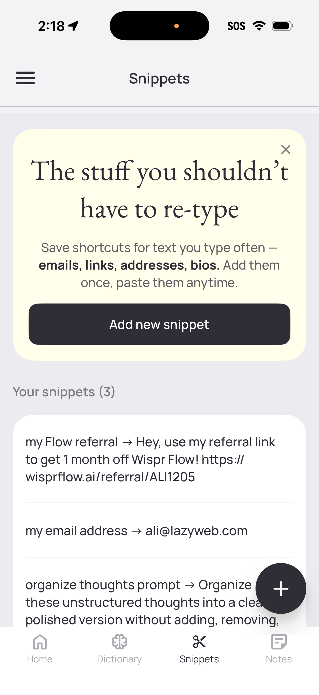
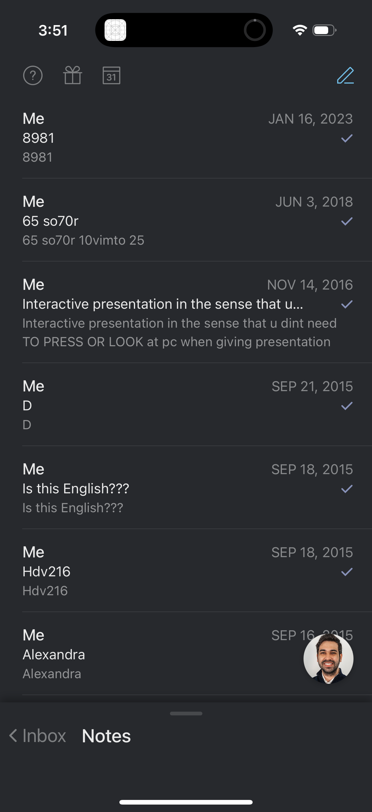
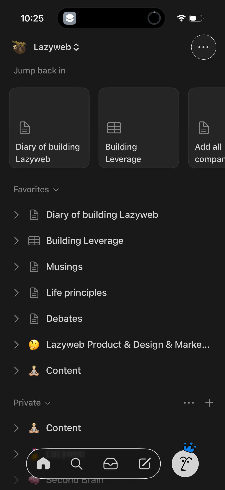
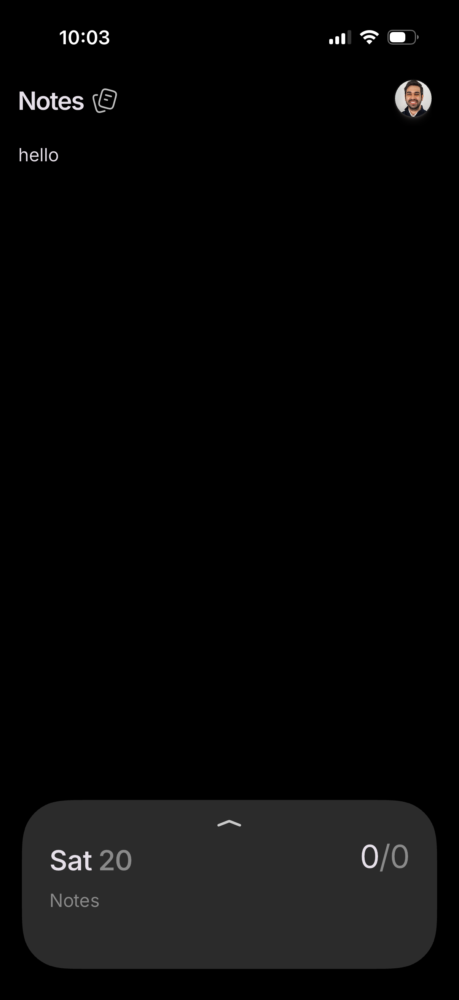
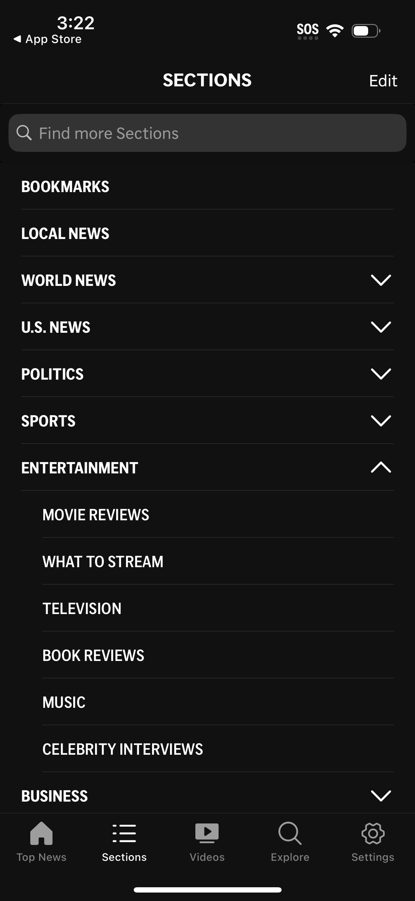
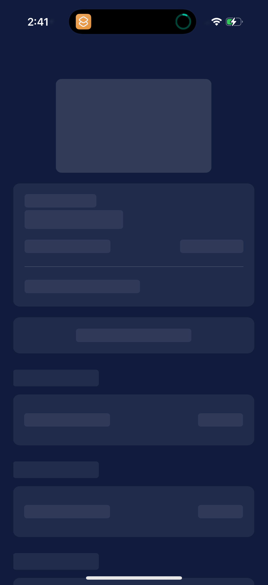
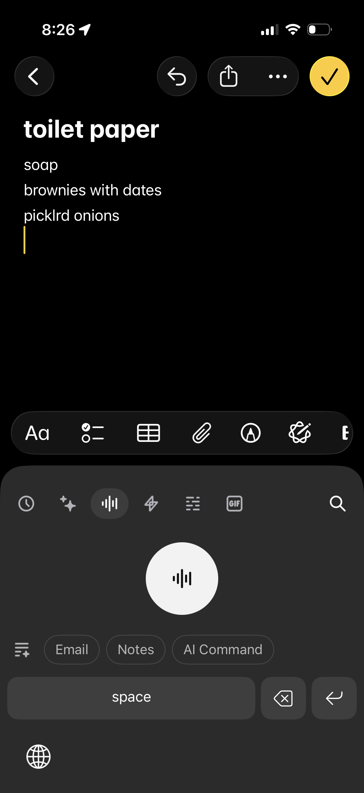

# Design Research: clipdeck frontend page

## TL;DR
Clipdeck is essentially a tap-to-copy snippet library — closest precedent is **WhisperFlow's "Snippets"** screen (name → content rows you tap to paste). The current design is already in the right neighborhood (dark theme, card-per-item, version chip, toast feedback). The biggest gaps vs. best-in-class are: **no search/filter for >20 items**, **no copy affordance per row** (the whole row is a button but nothing signals "this copies"), and **no skeleton loading state** (the empty "Loading…" string is dated).

## Current State

The clipdeck page (per `clipdeck/src/static/index.html` + `app.css`):

- Single-column grid on mobile, 2-column at ≥720px
- Toolbar with title + version + Reload button (hidden on touch)
- Cards: bold title, optional version pill, subtitle, description; resource-backed rows show a green left bar
- Tap card → copies body to clipboard → top-center toast "Copied"
- Dark palette: `#0f1117` bg, `#6c63ff` accent purple, `#3ecf8e` success green
- No screenshot was captured (no live URL provided). Description is taken from source files.

## Recommendations / Next Steps

In priority order. Each tied to evidence in the **Key Examples** and **Patterns** sections.

### 1. Add a filter input (sticky, top of `.sections`)
**Why:** Once the library has more than ~15 items, scanning by eye breaks. WhisperFlow, Notion, and Apple News all put a search field above grouped lists. The site is private/single-user so don't bother with fuzzy ranking — substring match across `title + subtitle + description` is enough.

```
┌─────────────────────────────────────────┐
│  clipdeck  v1.4.0          [Reload]     │
├─────────────────────────────────────────┤
│  🔍  Filter prompts and skills…         │  ← new
├─────────────────────────────────────────┤
│  PROMPTS                                │
│  ┌─────────────────────────────────────┐│
│  │ Code review checklist        v2.1   ││
│  │ Reviews PRs against CLAUDE.md       ││
│  └─────────────────────────────────────┘│
│  ┌─────────────────────────────────────┐│
│  │ Bug triage              v1.0  ▎     ││ ← resource bar
│  │ Routes incoming bug reports         ││
│  └─────────────────────────────────────┘│
└─────────────────────────────────────────┘
```

### 2. Make the "tap to copy" affordance explicit
**Why:** A row that looks like a card has no signal it's a button. When the user gets it wrong once (taps thinking it'll open), the toast saying "Copied" is delightful but jarring. Two options, in increasing intrusiveness:

- **Light:** add a small `📋` (or SVG clipboard icon) at the right edge of `.title-row`, ghosted to `--text-subtle`. It costs ~16px of width and removes all ambiguity.
- **Heavier:** a tiny "Tap to copy" hint in the section header, shown only until first successful copy (persisted in localStorage).

The current `cursor: pointer` plus `:active { transform: scale(0.995) }` is correct on desktop but invisible on iPhone (no hover, scale is too subtle for touch).

### 3. Replace the "Loading…" string with skeleton rows
**Why:** A pulsing word centered on a black screen looks broken on a slow GitHub fetch. Amex, and most modern dark-theme apps, show shimmer rectangles in the actual list shape. You already have the layout — render 3-4 grey-on-grey card stubs. The fade-in on the real data masks any layout jump.

```
┌─────────────────────────────────┐
│  ▓▓▓▓▓▓▓▓▓▓                     │   ← shimmer
│  ▓▓▓▓▓▓▓▓▓▓▓▓▓▓▓▓▓              │
├─────────────────────────────────┤
│  ▓▓▓▓▓▓▓▓                       │
│  ▓▓▓▓▓▓▓▓▓▓▓▓▓                  │
└─────────────────────────────────┘
```

### 4. Hold off on collapsible sections
**Why:** AP News collapses sections, but their list is 12+ deep categories. Clipdeck likely has 2-3 sections (prompts, skills, maybe agents). Collapsing them adds a tap with no payoff. Revisit only if section count exceeds 5.

### 5. Move the version chip from "centered baseline" to the top-right of the title row
**Why:** Current `align-items: baseline` works but a v-chip floating at the title baseline reads as part of the title. Notion and Linear treat metadata pills as right-aligned trailing accessories. Use `justify-content: space-between` or a small gap with explicit alignment.

### 6. Skip the bottom navigation bar (you already do — keep it that way)
**Why:** Almost every productivity app on mobile has a 4-tab bottom nav. Clipdeck is single-screen by design. Adding one would be cargo-culting. The current full-bleed list is correct. Worth calling out so it doesn't get added later "for consistency."

## Key Examples


*WhisperFlow — Snippets screen: name → content rows, primary "Add new snippet" CTA, list of saved name-to-content pairs. Closest 1:1 precedent for clipdeck. [Lazyweb]*


*Superhuman — Notes inbox with title + preview snippet + last-modified date per row. Demonstrates how clean a metadata-rich list can be without crowding. [Lazyweb]*


*Notion — Dark "Jump back in" + Favorites sections with chevron affordance. Validates clipdeck's section-grouped layout, but Notion makes section boundaries quieter than clipdeck's all-caps headers. [Lazyweb]*


*Persist — Minimal dark notes header with profile avatar. Reference for how restrained a single-screen toolbar can be. [Lazyweb]*


*AP News — Sections with searchable list and expand/collapse rows. **Anti-pattern for clipdeck**: only worth it once category count grows past ~5. [Lazyweb]*


*Amex — Dark skeleton/shimmer loading state. Replaces clipdeck's centered "Loading…" text. [Lazyweb]*


*Raycast — Dark list editor; Raycast (especially on macOS) is the strongest design comparator for "command palette over a list of stored items". The mobile screen is less direct but worth noting. [Lazyweb]*

## Patterns

What the strong examples share:

- **Grouped sections with quiet headers** — small uppercase or sentence-case labels in `--text-muted`, never compete with row titles. Clipdeck already nails this.
- **One primary metadata chip per row, max** — version, date, or tag. More than one and the title gets crowded.
- **Copy/share/action affordance is visible at row level** — even when the whole row is tappable, an icon at the trailing edge tells the user what'll happen.
- **Search/filter at top of list** appears once item count > ~10. WhisperFlow, Notion, AP News, Apple News all do this.
- **Loading = skeleton in the list shape**, not centered text. This is universal in 2026 mobile UX.
- **Toast confirms destructive or one-shot actions** — clipdeck's top-center pill toast matches Notion, Spotify, Uber Eats patterns.

## Anti-Patterns

What to avoid (seen in weaker results):

- **Centered "Loading…" text on a dark canvas** — looks broken until data arrives. Replace with skeleton.
- **Collapsible sections by default** — adds taps without payoff for small libraries.
- **Pull-to-refresh as the only reload** — fine as a bonus, but discoverability is poor. Clipdeck's explicit Reload button (on hover) is correct; consider exposing it on touch too, perhaps as a small icon button instead of hidden.
- **Multiple metadata badges crowding the title row** — saw this in shopping/finance results. Keep clipdeck's discipline of one version chip max.
- **Bottom tab bar on a single-screen app** — pure cargo cult; clipdeck wisely avoids it.
- **Card thumbnails / icons for non-visual content** — text-only items don't need a 40px circle on the left. Clipdeck correctly skips this.

## Unique Angles

The standout detail I'd consider stealing:

- **WhisperFlow's onboarding card on first load** — a one-time card above the list explaining "tap a snippet to copy, long-press to preview." Dismissable, never returns. Solves the "tap to copy" affordance problem (recommendation #2) without permanently cluttering the UI. Disappears after first successful copy.
- **The resource-backed green left bar** (3px) is a smart, low-cost signal. Most apps would have used a tag/chip; clipdeck uses spatial encoding. Keep this — it's the kind of detail that differentiates a well-designed tool from a generic list.

## Findings

The research surface here is wide but shallow — there are tens of thousands of "list of items, dark theme" screens, but clipdeck's specific problem ("private library where each tap copies content to clipboard") has very few direct precedents. WhisperFlow Snippets is the only direct 1:1; Raycast Snippets (macOS) is the spiritual ancestor; Apple Shortcuts and iOS Text Replacements are the closest system-level analogs.

That scarcity is actually informative: clipdeck doesn't need to imitate anyone closely. The pattern language is established (grouped list, dark theme, version chips, toast feedback), and the current implementation is competent. The remaining work is **affordance clarity** and **scale** (filter, skeleton loading), not visual redesign.

Lazyweb returned 2-3 strongly relevant matches per query and a long tail of weaker ones; web search confirmed copy-to-clipboard is a mature, well-documented pattern in 2026 design systems. No need for a ground-up rethink.

## Sources

Lazyweb screenshots cited inline above. Web sources:
- [The Ultimate AI Design Prompt Library 2026 — GenDesigns](https://gendesigns.ai/blog/ai-design-prompt-library-100-prompts)
- [78 SaaS Copy-to-Clipboard UI Examples — SaaSframe](https://www.saasframe.io/patterns/copy-to-clipboard)
- [Copy and Paste — Android Developers](https://developer.android.com/develop/ui/views/touch-and-input/copy-paste)
- [PatternFly — Clipboard Copy](https://www.patternfly.org/components/clipboard-copy/)
- [Copy to Clipboard — Cloudscape Design System (AWS)](https://cloudscape.design/components/copy-to-clipboard/)
- [Copy text — web.dev Patterns](https://web.dev/patterns/clipboard/copy-text)
- [UX Study: Copy to Clipboard — flaming.codes](https://flaming.codes/posts/ux-study-copy-to-clipboard-action-web-api/)
