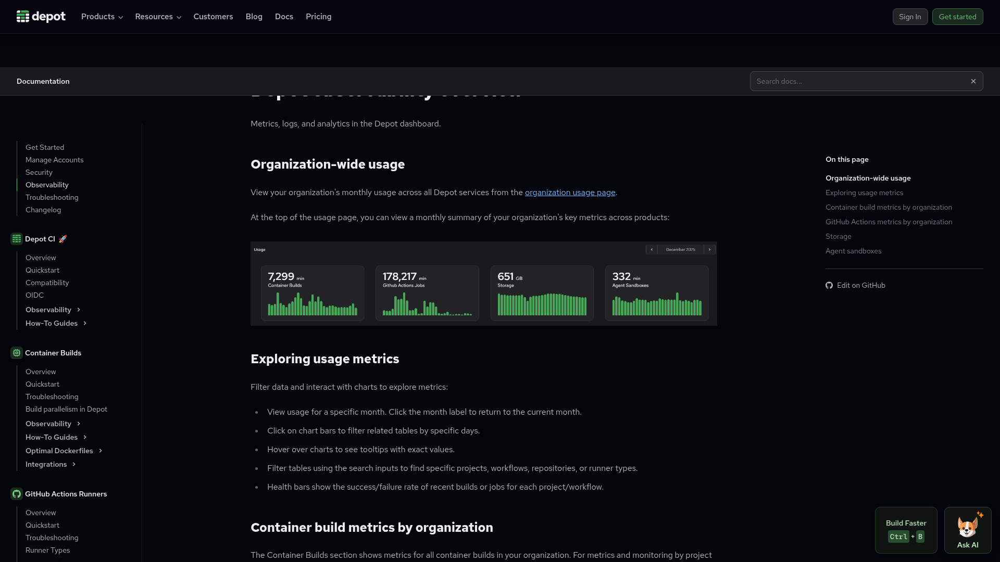
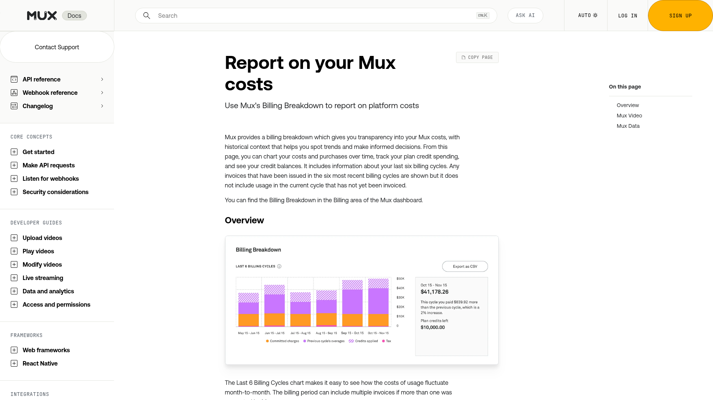
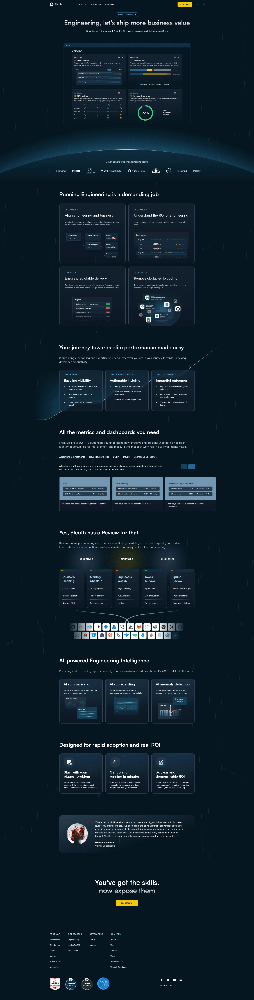
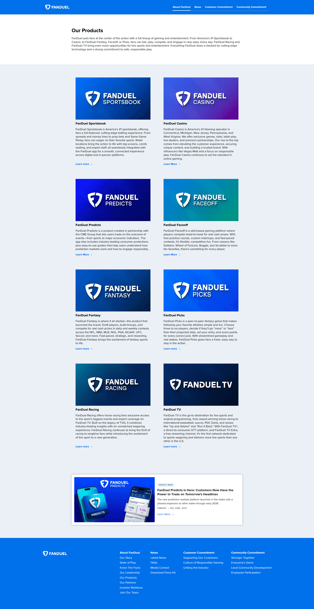
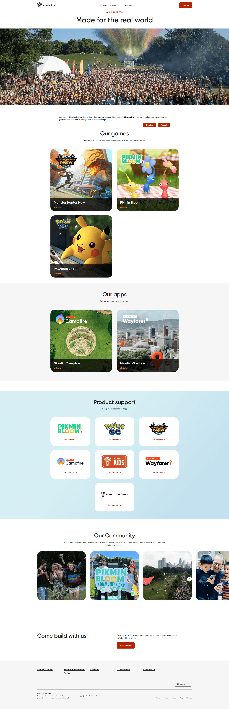

# Design Research: loc-dashboard.html

## TL;DR

The page bundles two unrelated jobs into one scroll: a **product portfolio** (19 cards) and a **codebase LOC stats** view. The product grid is solid; the LOC section's stacked horizontal bar chart is the weakest element — readers can only compare the leftmost (Code) segment cleanly, and the trailing 6 zero-rows clutter the chart without adding signal. Fix the chart first (split into two views or sort+filter), then tighten the KPI cards with sparklines and a single "primary" hero metric.

## Recommendations / Next Steps

1. **Replace the single stacked bar with a two-view treatment.** Stacked bars hide everything except the segment touching the baseline (well-documented anti-pattern; see Sources). Either (a) use **grouped/multi-series bars** so Code, Tests, Docs each share a baseline, or (b) keep the stacked bar but add a second compact "Test/Code ratio" lollipop chart so the ratio story you already tease in the badge has a real visualization. The Mux billing dashboard only stacks because totals are the story; you mostly want comparison, so grouped bars win.

```
   Before (stacked, hides Tests/Docs trends):
   notio  ████░░░░░████████░░░░░░██████████████░░  14,598
   oracle ██████░░░░██████████░░░░░██████░░░░░░░░  12,851

   After (grouped, all share baseline):
   notio   Code  ███░          2,815
           Tests █████░        4,604
           Docs  ████████░     7,179
   oracle  Code  ████░         3,428
           Tests ██████░       5,607
           Docs  █████░        3,816
```

2. **Hide or collapse the 6 zero-LOC rows** (`agents`, `nexum`, `niora`, `dragoman`, `doc-drift-agent`, plus `repo-scripts` with 0 docs). They produce visually empty bars that punish the eye scanning down. Collapse them under an "Empty / docs-only projects (6)" disclosure, or move them to a small "Concept / planning" section above the chart.

3. **Promote one hero metric using the 40-30-20-10 rule.** Right now the four cards (Code/Tests/Docs/Total) are equal in weight — but the badge "Test/Code ratio: 1.4×" is the most editorially interesting number on the page. Make Test/Code ratio (or "Total LOC") the dominant card at ~40% of the metric strip, then 3 secondary at 60%. F-pattern eye-tracking research says the top-left KPI gets the most attention — give it to the metric you actually want readers to remember.

```
   Before:                              After:
   ┌────┬────┬────┬────┐                ┌──────────┬───┬───┬───┐
   │104K│ 19K│ 27K│ 57K│                │ 1.4×     │19K│27K│57K│
   │TOT │CODE│TEST│DOCS│                │ Test:Code│CDE│TST│DOC│
   └────┴────┴────┴────┘                │ healthy  │   │   │   │
                                        └──────────┴───┴───┴───┘
```

4. **Add tiny sparklines or a context line under each card.** A bare number is a dead number. "19,166 Code" gains value if it says "↗ +1.2k this month" or shows a 30-day trend. Power BI's 2026 native sparkline guidance and Depot's developer dashboard both do this. Even a single comparison ("57,729 Docs · 3.0× code") tells a story.

5. **Add a `LAST UPDATED` timestamp.** Right now the footer just says `loc-dashboard.sh` — no date. Stats dashboards lose all credibility when readers can't tell if the numbers are from today or six months ago. One line: `Last updated: 2026-05-10 from loc-dashboard.sh`.

6. **Separate "Products" and "Codebase" with a stronger visual divider** (or honestly, two pages). Right now they are one continuous section with the same `section-title` style. A reader scanning for codebase facts has to scroll past 19 product cards to reach them. Either: anchor links at top, a route split (`/products`, `/loc`), or a visible h-rule + breathing room between the two sections.

7. **Tighten card density on the products grid** by introducing a subtle category grouping (CLI / Web App / MCP Server / Service / Concept). 19 cards in a flat 2-column grid blurs together; a soft category label between rows helps the reader build a mental map. Keep the existing card design — it's solid.

## Key Examples


*Depot — Summary cards (builds, deploys, containers) above a per-organization breakdown bar chart with a real time-series line above it. Closest pattern to what the LOC dashboard is trying to do, and shows how trend context elevates raw counts. [Lazyweb]*


*Mux — Stacked bar tracking platform-type costs over time. Stacking is justified here because the **total** is what the user pays. On the LOC dashboard, totals matter less than category comparison — which is why grouped bars would serve readers better. [Lazyweb]*


*Sleuth — Dark-themed engineering metrics with a clear "at-a-glance" header strip, then deeper drill-down panels. Note how each metric has a comparison frame (target/elite/skill tiers), not just a raw number. [Lazyweb]*


*FanDuel — Marketing-grade portfolio grid: 8 product cards each with a short description and "Learn more" link. Card stack is uniform, but each card has a clear product-line color hint. The ai-labs grid uses a single accent — adding subtle category-keyed accents would help wayfinding without clutter. [Lazyweb]*


*Niantic — Hero + feature-card grid pattern. Product cards include a thumbnail and a single CTA. ai-labs' card-only treatment (no thumbnail) is more sober and code-appropriate; this reference is here to show what NOT to copy: the marketing-heavy hero would feel wrong on an internal stats page. [Lazyweb]*

## Patterns

These are the table stakes the strong references share:

- **Summary KPI cards above the breakdown chart.** Universal. The LOC dashboard already does this.
- **Hover or focus state on rows/cards.** ai-labs already has this on product cards (the radial gradient on hover is a nice touch). Add a similar hover on bar-chart rows so the row reads as interactive.
- **Tabular numerals and right-aligned numbers in tables.** ai-labs already does this (`font-variant-numeric: tabular-nums`). Keep it.
- **Color encoding that survives the legend.** Code = green, Tests = orange, Docs = blue is fine and roughly matches industry convention (green=passing, orange=warn, blue=info).
- **Sticky or pinned context** — best dashboards keep the legend visible while the chart scrolls. Not critical here since the chart fits one viewport, but worth knowing.

## Anti-Patterns

What to avoid; some are present in the current design:

- **Stacked bars when comparison is the goal.** "Stacked bars are the worst" is a famous critique by Robert Kosara — only the segment on the baseline can be compared accurately. The current chart hits this exactly: you can read Code across projects, but Tests and Docs become eyeballed estimates because their starting points shift per-row. (See `eagereyes.org` source.)
- **Equal-weight KPI cards.** Four identical cards forces the reader to read all of them; cognitive load research caps useful KPI counts at ~5 with a clear primary. The dashboard has 4, which is fine, but they're undifferentiated.
- **Zero-value rows in the chart.** 6 of 20 projects render as empty bars. They consume vertical space without communicating anything except "this project is empty." Hide them or collapse them.
- **Bare numbers without context.** `19,166 Code` — is that good? Big? Up? Down? No way to tell. Add a delta, a sparkline, or a comparator.
- **No "as of" date.** Trust-killer for any stats page.
- **Two unrelated jobs in one scroll.** The product portfolio and the LOC stats serve different readers (recruiter / collaborator vs. yourself / engineer). They're stapled together by URL only.

## Unique Angles

The standout move worth keeping or amplifying:

- **The mouse-glow gradient on product cards.** The radial-gradient-following-cursor effect is a small detail but it's the kind of thing that makes a static page feel alive without being noisy. It's the X100 detail of this page.
- **The "Test/Code ratio: 1.4×" badge.** Most LOC dashboards stop at totals. Computing and surfacing the ratio is editorial — it tells you something about the codebase's character. Lean into this: add 1-2 more derived ratios (Docs/Code, Tests-of-projects-with-tests, etc.) and elevate them above the raw totals.

## Findings

The dashboard's current structure is two-sections-glued-together. The Products section is the more polished half — clean card design, working hover states, sensible type scale. The LOC section is functional but reads like a port of a CLI tool's output: numbers in cells, a chart, a table. It hasn't yet been *designed* — it's been *displayed*.

The fix isn't a redesign. It's three targeted moves:

1. **Replace the stacked bar with a chart that lets the eye compare across rows.** This is the single highest-leverage change. The data isn't bad; the encoding is.
2. **Promote the editorial number** (the ratio) and add one trend signal per KPI. This converts dead numbers into a story.
3. **Decouple the two sections.** Either visually (clear divider, anchor nav) or structurally (two pages). They serve different readers.

The product portfolio half is good enough to ship as-is. The bigger remaining question for that half is whether 19 flat cards is the right grouping; a light category cue (CLI / Service / MCP Server / Concept) would help readers build a map.

## Sources

Web research:
- [Stacked Bars Are the Worst — Robert Kosara, eagereyes](https://eagereyes.org/techniques/stacked-bars-are-the-worst)
- [Power BI Dashboard Design Best Practices: Enterprise Guide 2026 — EPC Group](https://www.epcgroup.net/power-bi-dashboard-design-best-practices-enterprise-2026)
- [Effective Dashboard Design: Principles, Best Practices, and Examples — DataCamp](https://www.datacamp.com/tutorial/dashboard-design-tutorial)
- [Better KPI visualizations in Power BI reports — Tabular Editor](https://tabulareditor.com/blog/kpi-card-best-practices-dashboard-design)
- [Understanding Stacked Bar Charts: The Worst Or The Best? — Smashing Magazine](https://www.smashingmagazine.com/2017/03/understanding-stacked-bar-charts/)
- [Bad data visualization: how to notice and fix it — Datylon](https://www.datylon.com/blog/bad-data-visualization-examples)
- [10 Data Visualization Mistakes to Avoid in 2026 — clariBI](https://claribi.com/blog/post/data-visualization-mistakes-to-avoid/)
- [Code Coverage: Metrics, Tools & Tips — Augment Code](https://www.augmentcode.com/guides/code-coverage-metrics-tools-and-tips)

Lazyweb screenshots cited inline above (Depot, Mux, Sleuth, FanDuel, Niantic).
