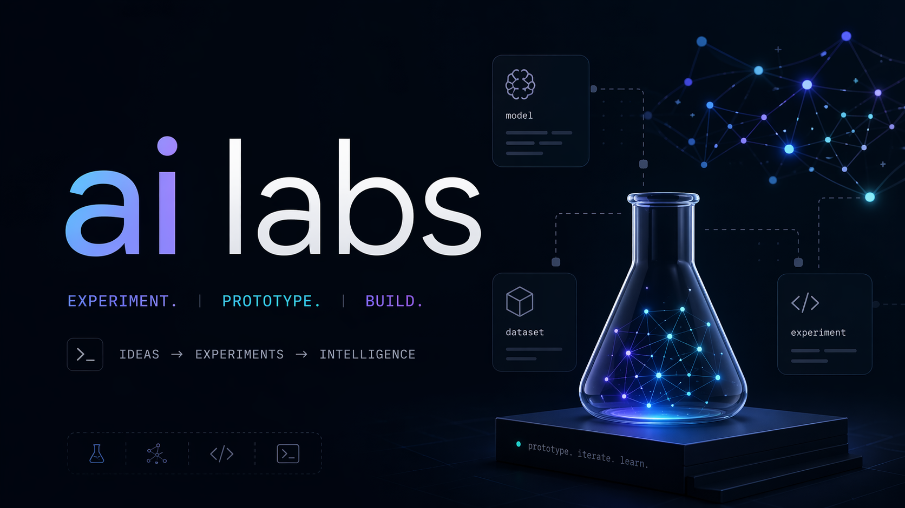

# ai-labs



Applied AI experiments and systems engineering.

This repo also holds a reusable library of agent-oriented instructions, prompts, skills, and exploratory tooling for AI-assisted development.

## Agent-Agnostic Instructions

AI tools and interfaces change quickly. The repo treats high-quality instructions as durable, version-controlled assets rather than tool-specific glue.

The practical split is between:

- `migrate-to-skills/guides/` for foundational context, methodologies, and style guides that teach an agent how to think about a task
- `prompts/` for focused one-shot instructions that tell an agent what to do next

The usual pattern is to combine a guide with a prompt when working with a chosen agent.

`CLAUDE.md` is the canonical agent instruction file. `AGENTS.md` is a symlink to it — do not reverse the direction (web-based agents cannot follow symlinks).

## Structure

| Path | Purpose |
|------|---------|
| `agents/` | OpenClaw agent-fleet operational docs (runbook, gotchas, shared README/TODO) and the nested `maestro-flow-review-agent/`, `doc-drift-agent/`, `product-research-agent/`, and `hermes-memory-review-agent/` definitions |
| `migrate-to-skills/guides/` | Foundational methodologies and style guides for AI-assisted work |
| `prompts/` | Focused one-shot task instructions |
| `dev-skills/` | Development workspace for Claude Code skills; published to `igor1309/skills` |
| `tools/` | Small shell utilities and local workflow helpers |
| `tools/mac-health/` | Scheduled launchd-driven macOS health checks (memory, disk, leftovers) — JSONL log + threshold notifications, no resident process |
| `sandbox/` | Experiments and WIP explorations |
| `insights/` | Notes on AI tooling and usage patterns |
| `reading/` | Reading notes and curated references |
| `debates/` | Long-form debates and synthesis docs |
| `research/gemini/` | Gemini-specific prompt and workflow notes |

## AI Tooling

- Skills are developed in `dev-skills/public/` and synced to `igor1309/skills` on push to `trunk`
- `sandbox/`, `research/`, and `archive/` are excluded from publish via `dev-skills/public/.publishignore`
- Published skills can be installed with `/plugin marketplace add igor1309/skills`

## Components

| Component | Type | Description |
|-----------|------|-------------|
| agents | Agent definitions | OpenClaw agent-fleet operational docs and nested specialized agent definitions |
| agonara | Application | Bring-your-own-agent (BYOA) structured learning program environment. API-first backend with `/learn`/`/admin` UIs and an operator CLI as first-class clients; curated programs, learner progression, evidence of mastery |
| nexum | Application | Private repo memory system |
| notio | Service | Personal capture service |
| notio-backend | Release unit | Swift/Hummingbird Telegram capture service, Supabase schema/migrations owner, Docker-producing VPS deployable |
| notio-frontend | Release unit | Svelte/Vite Supabase browse client, Cloudflare Pages deployable |
| oracle | Web App | "Oracle — Am I Done?" One-shot career outlook tool |
| reinix | CLI release unit | Workflow runner for governed coding-agent loops |
| agister | CLI (Go) | Agister orchestrator, CLI stage: generic agent calls through Claude Code, with opt-in Codex, Pi, and OpenCode adapters (Codex and OpenCode pending live verification); agents, processes, policies, permission mappings and output contracts are settings (ADR-001); no service yet |
| gokit | Library (Go) | Reusable Go packages extracted from Agister (ADR-019): process supervisor, manual clock, fake program and shell, in-process starter, test-discipline check |
| nomos | Service | AI sovereignty layer |
| corpus-scout | MCP tool | Lexical search over a local text corpus |
| web-scout | MCP tool | SearXNG search for Claude Code |
| loki | Service (on hold) | Centralized logging stack |
| claude-insights | Tooling | Weekly Claude Code usage reports |
| session-digest | CLI | Claude Code session postmortems |
| docker/langfuse | Observability | Shared Langfuse v4 instance for tracing and cost tracking |
| dragoman | Editorial channel | "The Dragoman" Telegram channel |
| clipdeck | Web App | iPhone copy library for private prompts and skills |
| ntfy-sender | Static page | iPhone-friendly page for sending ntfy notifications, deployed to Cloudflare Pages |
| dashboard-sync-agent | Agent definition | Dashboard and loc-script sync |
| neris | Framework | Agentic execution layer in Swift |
| warder | Tool (docs stage) | Local monitor for AI-agent runs: periodically observes active coding-agent sessions and publishes timestamped observations for other programs to consume; MVP specification and name brief only, no code yet |
| cairana | Product (research) | AI assistant for psychologists. Turns sessions into structured notes, case context, and next steps; working name in naming-validation stage |
| noreta | Product | Local hub for coding-agent sessions across Claude Code, Codex and Pi — one view of active and past work, with search, grouping, history and project context; read-only macOS MVP; all seven QA features have a domain implementation and a test per scenario; Claude Code adapters read real sessions, their runtime state and transcripts from disk, and `npm start` lists them as plain text; no Codex adapter yet |
| foliotell | App family | Native document-to-speech apps that read local Markdown and plain-text files aloud: shipping iOS app (release unit `foliotell`, in `ios/`) with Apple speech synthesis; Android sibling app in `android/` (Kotlin/Compose reader with platform TTS, Stage 1 of the Android roadmap) |
| tools | Tooling | Developer workflow helpers |
| dev-skills | Tooling | Claude Code skills marketplace |
| sandbox | Research | Experiments and prototypes |

## Architecture

Architecture Decision Records (ADRs) live in `docs/adr/`, organized by domain:

- `docs/adr/release/` — Release architecture (ADR-000 through ADR-006): independent per-unit releases, config-driven discovery, tag-based detection, Docker image tagging.
- ADR governance (structure template, review standard, implementation plan requirements) is bundled in the `adr-governance` skill (`dev-skills/public/adr-governance/references/`).

## Releases

Configured release units are trunk-only, semver-based, and tag-driven (`<basename>_v<version>`). See `release-units.config.toml` for discovery paths and `release-units.toml` for the current manifest. Full release policy is in `CLAUDE.md` under "Release Process".

## LOC Dashboard

```bash
# sorted by project name (default)
bash scripts/loc-dashboard.sh

# sorted by total descending
bash scripts/loc-dashboard.sh --sort=total
```
