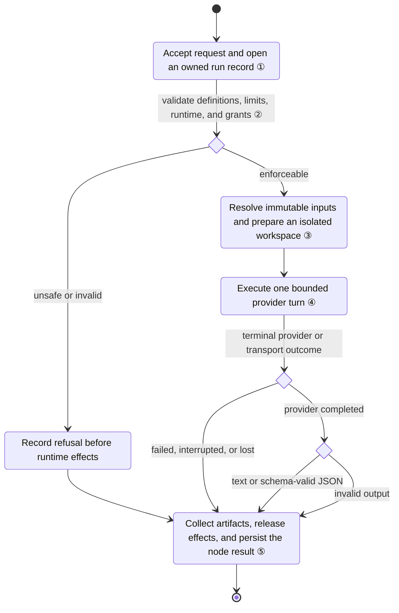
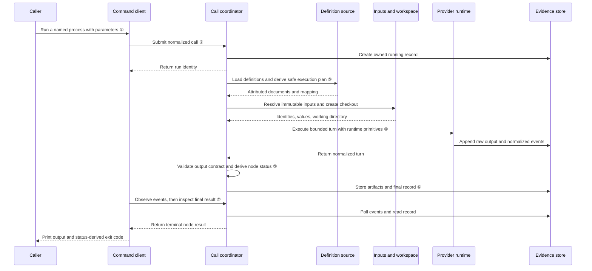

# Commit 5467ad: Agister CLI implementation inspection

## Part 1. For the developer

Commit `5467adadd4772685d7e811339134df4908841c64` is a clean merge of the feature branch that introduces the Go-based Agister CLI. The inspected scenario is one `agister run <process>` call, from settings-driven resolution and permission planning through a Claude Code or Codex subprocess to durable evidence and a normalized node result; workflow orchestration and a persistent service are explicitly outside this stage.

The merge itself contains no conflict-resolution delta: its tree is identical to second parent `4ef3a60f2`; relative to first parent `4da3e2c05`, it adds 85 files, 10,338 lines, the full `agister/` module, examples, documentation, and CI integration.

### Key entities

| Entity | Role | Primary implementation |
|---|---|---|
| CLI client | Parses commands, submits a call, observes it, prints output, maps node status to process exit code | [agister/internal/cli/cli.go:81 — Run](../../internal/cli/cli.go#L81), [agister/internal/cli/cli.go:341 — follow](../../internal/cli/cli.go#L341) |
| Client contract | Service-shaped API separating submit, observe, cancel, and inspect | [agister/internal/contract/contract.go:14 — Client](../../internal/contract/contract.go#L14) |
| Composition root | Wires definition/evidence stores, input providers, runtime adapters, validator, workspaces, and use cases | [agister/cmd/agister/main.go:41 — compose](../../cmd/agister/main.go#L41) |
| Call use case | Owns the asynchronous call lifecycle, pre-effect refusals, input/workspace preparation, runtime call, artifacts, and finalization | [agister/internal/app/calls.go:19 — Calls](../../internal/app/calls.go#L19), [agister/internal/app/calls.go:101 — execute](../../internal/app/calls.go#L101) |
| Resolver | Loads and validates definitions, narrows limits, verifies runtime identity/version, and builds an enforcement plan | [agister/internal/app/resolve.go:51 — resolver.resolve](../../internal/app/resolve.go#L51) |
| Policy/enforcement domain | Enforces `service ⊇ policy ⊇ process ⊇ caller` and converts permissions to safe runtime primitives | [agister/internal/domain/policy/policy.go:47 — Compose](../../internal/domain/policy/policy.go#L47), [agister/internal/domain/enforce/enforce.go:31 — Make](../../internal/domain/enforce/enforce.go#L31) |
| Runtime boundary | Keeps the core runtime-neutral; adapters receive primitives, not policies or permissions | [agister/internal/app/ports.go:45 — TurnRequest and TurnRunner](../../internal/app/ports.go#L45) |
| Runtime adapters/supervisor | Translate a turn into provider CLI flags/protocol, supervise the process group, and normalize provider events and outcomes | [agister/internal/adapters/runtime/claudecode/claudecode.go:108 — Claude Code RunTurn](../../internal/adapters/runtime/claudecode/claudecode.go#L108), [agister/internal/adapters/runtime/codex/codex.go:97 — Codex RunTurn](../../internal/adapters/runtime/codex/codex.go#L97), [agister/internal/adapters/runtime/supervisor/supervisor.go:46 — supervisor.Run](../../internal/adapters/runtime/supervisor/supervisor.go#L46) |
| Run model/store | Defines the uniform node result and persists atomic records, ordered events, raw provider output, ownership, and artifacts | [agister/internal/domain/run/run.go:128 — Result](../../internal/domain/run/run.go#L128), [agister/internal/domain/run/run.go:197 — Record](../../internal/domain/run/run.go#L197), [agister/internal/adapters/fsruns/fsruns.go:42 — Store.Create](../../internal/adapters/fsruns/fsruns.go#L42) |

### How it works

- `agister run` converts flags into a `CallRequest`, submits it, then follows its event stream until inspection returns a terminal result. Interrupting an owned call cancels it; interrupting `runs watch` only stops watching.
- Submission creates the evidence record before starting an asynchronous goroutine. Consequently, even missing or invalid definitions become a recorded `failed/refused` node rather than a synchronous CLI error.
- Resolution strictly parses service, process, optional policy, agent, runtime mapping, and output schema; caller limits may only narrow; runtime contract/version/capabilities must match; every selected primitive must grant only effective permissions.
- Parameters are bound into declared input providers. Git revisions become commit SHAs; files and derived diffs become digests. A process may get a detached worktree for the resolved candidate revision, isolated from Agister state.
- The core constructs provider-neutral prompt/instruction data and passes only runtime primitives. The adapter launches one provider CLI process, emits normalized events, and returns a normalized turn.
- A runtime failure is never upgraded. A completed structured turn is completed only if JSON Schema validation succeeds. The call then captures owned-workspace changes, releases the workspace, persists a uniform result, and releases the run ownership lock.
- The main side effects are `<home>/runs/<id>/` evidence, `<home>/logs/agister.jsonl` diagnostics, temporary detached worktrees, runtime subprocesses, and optional `changes.patch` artifacts.

### Scenario state diagram



| Marker | Code |
|---|---|
| ① | [agister/internal/app/calls.go:68 — Calls.Submit](../../internal/app/calls.go#L68)<br>[agister/internal/adapters/fsruns/fsruns.go:42 — Store.Create](../../internal/adapters/fsruns/fsruns.go#L42) |
| ② | [agister/internal/app/resolve.go:51 — resolver.resolve](../../internal/app/resolve.go#L51)<br>[agister/internal/domain/policy/policy.go:47 — policy.Compose](../../internal/domain/policy/policy.go#L47)<br>[agister/internal/domain/enforce/enforce.go:31 — enforce.Make](../../internal/domain/enforce/enforce.go#L31) |
| ③ | [agister/internal/app/calls.go:321 — Calls.resolveInputs](../../internal/app/calls.go#L321)<br>[agister/internal/app/calls.go:367 — Calls.prepareWorkspace](../../internal/app/calls.go#L367) |
| ④ | [agister/internal/app/calls.go:242 — runtime turn invocation](../../internal/app/calls.go#L242)<br>[agister/internal/adapters/runtime/supervisor/supervisor.go:46 — process supervision](../../internal/adapters/runtime/supervisor/supervisor.go#L46) |
| ⑤ | [agister/internal/app/calls.go:110 — finish closure](../../internal/app/calls.go#L110)<br>[agister/internal/domain/run/run.go:244 — run.Conclude](../../internal/domain/run/run.go#L244)<br>[agister/internal/adapters/fsruns/fsruns.go:111 — handle.Finish](../../internal/adapters/fsruns/fsruns.go#L111) |

### Sequence diagram



| Marker | Code |
|---|---|
| ① | [agister/internal/cli/cli.go:283 — run command](../../internal/cli/cli.go#L283) |
| ② | [agister/internal/contract/contract.go:24 — Client.Submit contract](../../internal/contract/contract.go#L24)<br>[agister/internal/app/calls.go:68 — Calls.Submit](../../internal/app/calls.go#L68) |
| ③ | [agister/internal/app/resolve.go:51 — resolver.resolve](../../internal/app/resolve.go#L51) |
| ④ | [agister/internal/app/ports.go:45 — TurnRequest](../../internal/app/ports.go#L45)<br>[agister/internal/adapters/runtime/supervisor/supervisor.go:46 — supervisor.Run](../../internal/adapters/runtime/supervisor/supervisor.go#L46) |
| ⑤ | [agister/internal/adapters/schema/schema.go:39 — Validator.Validate](../../internal/adapters/schema/schema.go#L39)<br>[agister/internal/domain/run/run.go:244 — run.Conclude](../../internal/domain/run/run.go#L244) |
| ⑥ | [agister/internal/app/calls.go:302 — Calls.collectChanges](../../internal/app/calls.go#L302)<br>[agister/internal/adapters/fsruns/fsruns.go:111 — handle.Finish](../../internal/adapters/fsruns/fsruns.go#L111) |
| ⑦ | [agister/internal/cli/cli.go:341 — follow](../../internal/cli/cli.go#L341)<br>[agister/internal/app/runs.go:21 — Runs.Observe](../../internal/app/runs.go#L21) |

## Part 2. Context for an agent

### Scope and commit facts

- Target commit: `5467adadd4772685d7e811339134df4908841c64`, merge parents `4da3e2c054b6315d85d7948e0e69f5d1cd36a4e3` and `4ef3a60f2e16d046065850767500c222788c9843`.
- `git diff 4ef3a60f2..5467ad` is empty and `git show --remerge-diff 5467ad` has no merge-resolution patch. Explain the feature branch, not a synthetic merge fix.
- First-parent delta: 85 files, 10,338 insertions, 3 deletions. It creates a standalone Go module, examples, ADR/deferred findings, tests, and a reusable CI workflow; root CI invokes it for relevant path changes at [.github/workflows/ci.yml:141 — Agister path filter](../../../.github/workflows/ci.yml#L141) and [.github/workflows/ci.yml:227 — agister-core job](../../../.github/workflows/ci.yml#L227).
- Feature-branch evolution: initial Claude adapter, Codex adapter, composition/logging, settings-defined processes/policies, ADR, complete CLI-to-ADR implementation, checker/tests/CI, fail-closed fixes, deferred-work evidence, cancellation deregistration, unified node result/runtime hardening, and a Git-test cleanup race fix.
- Interpretation chosen: “implementation of the commit” means the resulting Agister CLI subsystem, with the concrete `agister run` scenario as the central path. The merge also exposes `init`, `check`, agent/process inspection, run listing/show/watch, and cancellation, but those are secondary.

### Architecture and dependency direction

```text
cmd/agister (composition only)
  -> internal/cli -> internal/contract
  -> internal/app -> internal/contract + internal/domain/*
  -> internal/adapters/* -> app/domain/contract ports
internal/domain/* -> pure rules + definition parsers
```

- `cmd/agister` is the sole concrete wiring point: filesystem definitions/evidence/provenance, Git input/workspace adapters, JSON Schema validation, Claude/Codex runtime factories, clock/IDs, diagnostics decorators, and the in-process host are registered at [agister/cmd/agister/main.go:41 — compose](../../cmd/agister/main.go#L41).
- `app.Host` embeds use-case groups to satisfy the service-shaped client interface at [agister/internal/app/host.go:7 — Host](../../internal/app/host.go#L7). This is intentionally replaceable by a future service transport.
- Architecture tests mechanically prevent domain/app/CLI dependency inversions, restrict adapter imports to the composition root, and assert production Go code contains no task-specific “review/verdict/finding” vocabulary at [agister/internal/archtest/architecture_test.go:44 — TestDependencyRule](../../internal/archtest/architecture_test.go#L44), [agister/internal/archtest/architecture_test.go:76 — TestOnlyTheCompositionRootImportsAdapters](../../internal/archtest/architecture_test.go#L76), and [agister/internal/archtest/architecture_test.go:90 — TestCodeKnowsNoKindOfWork](../../internal/archtest/architecture_test.go#L90).

### Configuration model

- Flat service/agent settings are TOML. `Service` defines maximum timeout/attempts/cost, the permission vocabulary, and never-grant `state_reaching` permissions; `Agent` defines runtime mapping, model/family/effort, command override, and session policy at [agister/internal/domain/definition/toml.go:24 — Agent](../../internal/domain/definition/toml.go#L24) and [agister/internal/domain/definition/toml.go:43 — Service](../../internal/domain/definition/toml.go#L43).
- Hierarchical process/policy/runtime mappings are strict YAML. Unknown fields and type errors are accumulated through the node-level parser at [agister/internal/domain/definition/yaml.go:46 — fields](../../internal/domain/definition/yaml.go#L46).
- A `Process` is the settings-only unit of work: agent reference, optional policy, instruction, parameters, input values/sources, optional checkout, required permissions, output contract, and narrower limits at [agister/internal/domain/definition/documents.go:45 — Process](../../internal/domain/definition/documents.go#L45). `ParseProcess` validates cross-references and supported output forms at [agister/internal/domain/definition/documents.go:95 — ParseProcess](../../internal/domain/definition/documents.go#L95).
- A runtime `Mapping` names an adapter contract/version prefix and maps provider primitives to every permission they actually grant at [agister/internal/domain/definition/documents.go:66 — Mapping](../../internal/domain/definition/documents.go#L66). The shipped Claude mapping deliberately treats `Bash` as granting everything, because a narrower read-command allowlist was observed to fail open at [agister/examples/settings/runtimes/claude-code.yaml:21 — Bash mapping](../../examples/settings/runtimes/claude-code.yaml#L21).
- The example adversarial review is entirely settings-defined: inputs resolve base/candidate revisions, diff, and changed files; a detached checkout uses the candidate revision; output must validate against a named schema at [agister/examples/settings/processes/adversarial_review.yaml:3 — adversarial_review process](../../examples/settings/processes/adversarial_review.yaml#L3). Its policy gives read/search/diff only, denies write/process/network, enforces a 20-minute/$3 bound, and rejects same-model-family review when provenance is known at [agister/examples/settings/policies/static-review.yaml:4 — static-review policy](../../examples/settings/policies/static-review.yaml#L4).

### Exact call chain and invariants

1. `main` installs SIGINT/SIGTERM cancellation and invokes the CLI at [agister/cmd/agister/main.go:31 — main](../../cmd/agister/main.go#L31). The CLI accepts flags among positionals, parses `--max-cost`, builds `CallRequest`, calls `Submit`, then `follow` at [agister/internal/cli/cli.go:283 — run dispatch](../../internal/cli/cli.go#L283).
2. `Calls.Submit` synchronously allocates a run ID, creates/locks the evidence directory, derives a cancellation context detached from request cancellation, registers it in `Hosted`, and starts `execute` in a goroutine at [agister/internal/app/calls.go:68 — Calls.Submit](../../internal/app/calls.go#L68). Invariant: every accepted submission has evidence even if later refused.
3. `resolver.resolve` loads `service -> process -> policy? -> agent -> runtime mapping -> schema?`, retaining every source digest. It compiles schema before spend, composes limits, asks the runtime for identity, verifies adapter contract/version and cost-limit support, then generates an enforcement plan at [agister/internal/app/resolve.go:51 — resolver.resolve](../../internal/app/resolve.go#L51).
4. `policy.Compose` rejects widening rather than silently clamping. Denials win; read-only implies repository-write/history-write denial; required permissions must remain effective; process constraints can be added but not replace policy constraints at [agister/internal/domain/policy/policy.go:46 — Compose](../../internal/domain/policy/policy.go#L46).
5. `enforce.Make` first removes state-reaching permissions. For `select: one`, it picks the fitting primitive with the broadest safe grant set; otherwise it grants every fitting primitive. An allowed-but-unmapped permission is withheld; withholding a required permission refuses the call at [agister/internal/domain/enforce/enforce.go:29 — Make](../../internal/domain/enforce/enforce.go#L29).
6. Optional continuation is fail-closed: agent must be resumable; runtime must support resume and preset session IDs; prior run must be finished, same agent/adapter, and contain a provider session at [agister/internal/app/calls.go:273 — Calls.continuation](../../internal/app/calls.go#L273).
7. `resolveInputs` rejects unknown/missing parameters, substitutes `${param.*}`, and delegates each declared value to its registered provider at [agister/internal/app/calls.go:321 — Calls.resolveInputs](../../internal/app/calls.go#L321). Git revisions resolve to commit SHAs; derived diff/file-list values use digests at [agister/internal/adapters/git/git.go:83 — Revision.Resolve](../../internal/adapters/git/git.go#L83) and [agister/internal/adapters/git/git.go:110 — Diff.Resolve](../../internal/adapters/git/git.go#L110).
8. Provenance constraints run before workspace/runtime effects. The implemented rule compares the agent model family with the recorded writer of the candidate revision; unknown provenance obeys explicit policy behavior at [agister/internal/app/calls.go:186 — constraint checks](../../internal/app/calls.go#L186).
9. `prepareWorkspace` prevents overlap in either direction between the repository/worktree and Agister state. Candidate scope creates a temporary detached Git worktree with an uncancelled release closure at [agister/internal/app/calls.go:367 — Calls.prepareWorkspace](../../internal/app/calls.go#L367) and [agister/internal/adapters/git/git.go:53 — Workspaces.Checkout](../../internal/adapters/git/git.go#L53).
10. Inputs become named prompt sections; the process instruction is augmented with granted/withheld permission facts at [agister/internal/domain/prompt/prompt.go:14 — Instruction](../../internal/domain/prompt/prompt.go#L14) and [agister/internal/domain/prompt/prompt.go:30 — Inputs](../../internal/domain/prompt/prompt.go#L30). Only `TurnRequest` primitives cross the runtime boundary.
11. The adapter returns a `Turn`. Structured output is revalidated centrally, then `run.Conclude` preserves non-completed runtime statuses and turns schema failures into `failed/invalid_output` at [agister/internal/domain/run/run.go:241 — Conclude](../../internal/domain/run/run.go#L241).
12. Finalization order is deliberate: capture `changes.patch` for owned workspaces, release the workspace, fill timing/status/error, append `CALL_FINISHED`, deregister cancellation, atomically write the finished record, then release its owner lock at [agister/internal/app/calls.go:110 — finish](../../internal/app/calls.go#L110) and [agister/internal/adapters/fsruns/fsruns.go:111 — handle.Finish](../../internal/adapters/fsruns/fsruns.go#L111).

### Runtime-specific behavior

| Concern | Claude Code | Codex |
|---|---|---|
| Contract | `claude-code/1`; version, preset session, resume, and soft cost-limit support reported at [agister/internal/adapters/runtime/claudecode/claudecode.go:50 — Identity](../../internal/adapters/runtime/claudecode/claudecode.go#L50) | `codex/1`; no preset/resume/cost-limit capability at [agister/internal/adapters/runtime/codex/codex.go:48 — Identity](../../internal/adapters/runtime/codex/codex.go#L48) |
| Restriction primitive | Any safe subset of tool names under `dontAsk`, `restricted`, and strict MCP settings at [agister/internal/adapters/runtime/claudecode/claudecode.go:63 — Arguments](../../internal/adapters/runtime/claudecode/claudecode.go#L63) | Exactly one sandbox mode (`read-only` or `workspace-write`), approvals never, user config/rules ignored at [agister/internal/adapters/runtime/codex/codex.go:61 — Arguments](../../internal/adapters/runtime/codex/codex.go#L61) |
| Protocol terminal | Claude `result`; stream events reduce to session/tool/text/retry/limit observations, then reconcile with process evidence at [agister/internal/adapters/runtime/claudecode/claudecode.go:238 — Stream.Reconcile](../../internal/adapters/runtime/claudecode/claudecode.go#L238) | Only `turn.completed`/`turn.failed`; top-level error events are non-terminal at [agister/internal/adapters/runtime/codex/codex.go:146 — Stream.Reduce](../../internal/adapters/runtime/codex/codex.go#L146) |
| Structured output | `--json-schema`, expects `structured_output` | Temporary 0600 schema file passed as `--output-schema`; final agent message must be JSON at [agister/internal/adapters/runtime/codex/codex.go:97 — RunTurn](../../internal/adapters/runtime/codex/codex.go#L97) |

Shared process supervision starts a process group, serializes concurrent stream/watcher events, keeps the last 4 KiB of stderr, sends SIGTERM on timeout/cancellation, escalates to SIGKILL after a grace period, and classifies missing terminal reports by transport evidence at [agister/internal/adapters/runtime/supervisor/supervisor.go:46 — Run](../../internal/adapters/runtime/supervisor/supervisor.go#L46) and [agister/internal/adapters/runtime/supervisor/supervisor.go:163 — WithoutTerminal](../../internal/adapters/runtime/supervisor/supervisor.go#L163).

### State, concurrency, and evidence

- `Hosted` is an in-memory mutex-protected `runID -> CancelFunc` map. Cancellation is possible only for calls hosted by the current process at [agister/internal/app/calls.go:36 — Hosted](../../internal/app/calls.go#L36) and [agister/internal/app/runs.go:48 — Runs.Cancel](../../internal/app/runs.go#L48).
- Each run directory contains atomic `record.json`, append-only `events.jsonl`, raw `provider.jsonl`, an owner lock, and artifacts. Writes inside one handle are mutex-serialized at [agister/internal/adapters/fsruns/fsruns.go:66 — handle](../../internal/adapters/fsruns/fsruns.go#L66).
- Record state is derived: `finished` if the record has `finished_at`; `running` if the owner flock is held; otherwise `abandoned`. A lock acquisition is followed by a record reread to close the finish/status race at [agister/internal/adapters/fsruns/fsruns.go:205 — Store.status](../../internal/adapters/fsruns/fsruns.go#L205).
- An abandoned record is projected to a uniform `lost/abandoned` result for clients at [agister/internal/app/runs.go:79 — Runs.view](../../internal/app/runs.go#L79).
- `Runs.Observe` polls every 50 ms by default and delivers sequence-numbered events after the supplied cursor until state is no longer running at [agister/internal/app/runs.go:21 — Runs.Observe](../../internal/app/runs.go#L21).
- Exit-code semantics derive only from node status/error class, not from the domain meaning of output; an unfavorable review verdict is still a completed node. The contract shape is at [agister/internal/contract/contract.go:131 — Result](../../internal/contract/contract.go#L131).

### Error/fallback map

- Definition, schema, narrowing, runtime identity/version/capability, enforcement, continuation, parameter/input, provenance, and state-overlap failures become recorded `failed/refused` outcomes before provider execution. Evidence: [agister/internal/app/calls_test.go:407 — TestRefusalsComeBeforeEffects](../../internal/app/calls_test.go#L407).
- Runtime terminal failures keep their class; timeout/cancel become `interrupted`; no terminal result, unexpected signal, or abandoned owner become `lost`; invalid structured output becomes `failed/invalid_output`. Class-to-status mapping: [agister/internal/domain/run/run.go:29 — failure classes](../../internal/domain/run/run.go#L29).
- Panics inside asynchronous execution are recovered and finalized as `failed/internal` at [agister/internal/app/calls.go:138 — panic recovery](../../internal/app/calls.go#L138).
- Artifact capture/release failures are evidence events and do not overwrite the call outcome. This preserves provider result authority but can leave cleanup residue.
- Large string input values over 2,000 characters are omitted from the record while immutable identity remains; the full value still goes to the runtime at [agister/internal/app/calls.go:410 — summarize](../../internal/app/calls.go#L410).

### Tests and validation evidence

- Local verification during this inspection: `go test ./...` passed for all packages on the checked-out commit. The race-enabled form was not run in this side inspection.
- End-to-end coverage proves immutable inputs, digested definitions, safe primitives, cost/session/timing normalization, worktree cleanup, diagnostic correlation, and event ordering at [agister/cmd/agister/main_test.go:128 — TestAgentCallEndToEnd](../../cmd/agister/main_test.go#L128).
- Additional wiring tests cover recorded refusals, settings-only extension, contract cancellation, verdict-as-output, continuation fork semantics, and workspace-change artifacts at [agister/cmd/agister/main_test.go:224 — TestRefusedCallIsRecorded](../../cmd/agister/main_test.go#L224), [agister/cmd/agister/main_test.go:237 — TestSettingsOnlyExtension](../../cmd/agister/main_test.go#L237), [agister/cmd/agister/main_test.go:314 — TestCancelThroughTheContract](../../cmd/agister/main_test.go#L314), [agister/cmd/agister/main_test.go:347 — TestVerdictIsOutputNotStatus](../../cmd/agister/main_test.go#L347), [agister/cmd/agister/main_test.go:357 — TestContinuationEndToEnd](../../cmd/agister/main_test.go#L357), and [agister/cmd/agister/main_test.go:400 — TestWorkspaceChangesAreKept](../../cmd/agister/main_test.go#L400).
- Both runtime adapters run the same conformance suite for identity, failure precedence, timeout, cancellation, spawn failure, no-result loss, and raw passthrough at [agister/internal/adapters/runtime/runtimetest/runtimetest.go:90 — Conformance](../../internal/adapters/runtime/runtimetest/runtimetest.go#L90).
- CI enforces formatting, vet, race tests with coverage, and a build/init/check smoke path at [.github/workflows/agister-core.yml:34 — validation steps](../../../.github/workflows/agister-core.yml#L34).

### Known limitations and extension radius

- SIGKILL of the Agister owner can leave the runtime process group and worktree alive; only the run is correctly recognized as abandoned. A persistent service/reaper is the intended fix at [agister/docs/deferred.md:6 — orphaned effects](../../docs/deferred.md#L6).
- `verified_versions` is manually asserted evidence, not mechanically linked to live primitive-verification runs. Claude write/network primitives and all Codex mapping behavior are not fully live-verified at [agister/docs/deferred.md:25 — mapping verification gap](../../docs/deferred.md#L25).
- Several provider failure classifications are heuristic/unobserved; fallback is safely `runtime_error` but may hide retryability at [agister/docs/deferred.md:46 — failure-class evidence gap](../../docs/deferred.md#L46).
- Claude cost enforcement is soft and may overshoot by one request; Codex calls with any effective cost cap are refused at [agister/docs/deferred.md:61 — soft cost limit](../../docs/deferred.md#L61).
- Adding a new kind of work should normally require only process/policy/schema/agent settings. Adding a new input source requires an `InputProvider` plus registration in `compose`; adding a runtime requires a `TurnRunner`, registry entry, mapping, fixtures/conformance tests, and live mapping verification; adding a new constraint mechanism touches definition parsing, policy composition, and pre-effect call checks.
- The service transition should retain `contract.Client` semantics and app use cases while replacing in-process hosting/observation/cancellation ownership with a durable transport and owner.

### Search trail and confidence

- Useful searches: `git show --stat`, first-parent/second-parent diffs, feature-branch log, `rg` for `Submit|execute|resolve|RunTurn|Finish|Observe|Conclude`, test names, and architecture rules.
- Read areas: CLI/contract/composition root, app ports/calls/resolution/runs, definition/policy/enforcement/prompt/run domain packages, Git/input/schema/evidence adapters, Claude/Codex/supervisor runtime path, examples, CI, end-to-end/conformance/architecture tests, deferred findings.
- Confidence: high for the implemented call path and merge topology, supported by direct code tracing and passing package tests. Medium for real-provider isolation and failure-class accuracy because the repository itself labels parts of those contracts as unverified or fixture-only.
