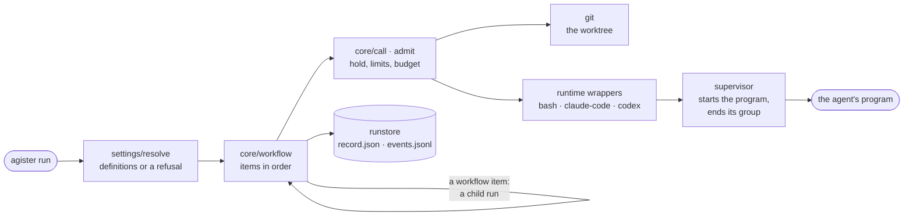
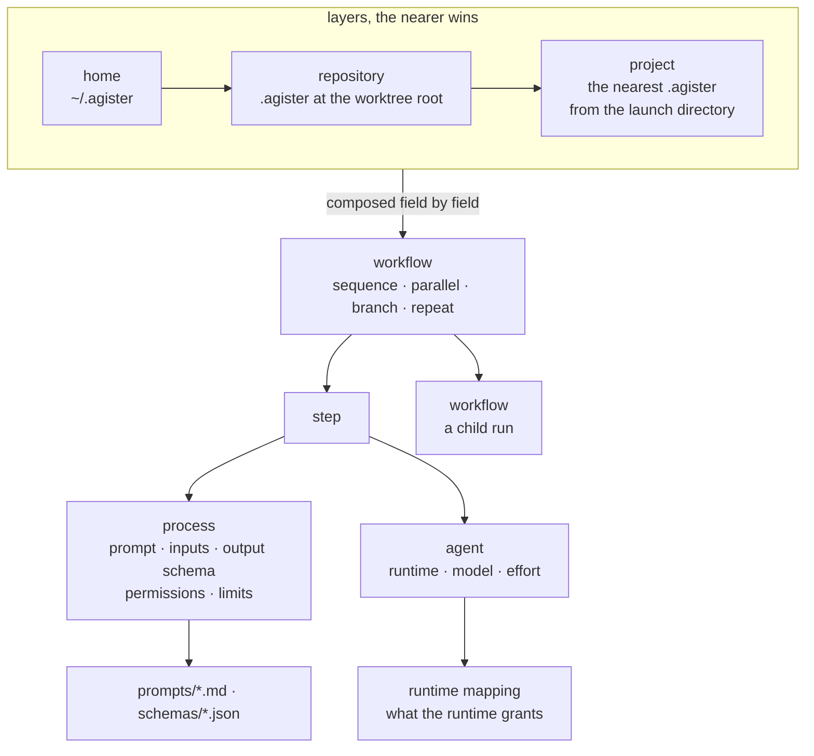

# Agister

Agister is a runner for AI-agent work defined in settings files.

You describe the work as settings, not code:

- an **agent** picks a runtime (Claude Code, Codex or bash) and, for a
  model, which model and effort;
- a **process** says what one call needs: its inputs, its prompt, the
  shape of its output and the permissions it asks for;
- a **workflow** composes steps, each a process on an agent, and other
  workflows, in sequence, in parallel, on a branch or in a repeat.

Agister resolves the settings before anything runs, runs each call in
your git worktree through its runtime, and keeps a record of every run:
the exact definitions with their digests, the inputs, the permission
plan, the events and the outcome. Every call ends in one result shape,
whichever runtime ran it.

Settings compose by field across three layers: home (`$AGISTER_HOME`,
else `~/.agister`), the repository's `.agister/`, and the nearest
project's `.agister/`. The [`home/`](home/) folder here is the home
Agister ships: its agents, the processes and workflows of a multi-lens
code review, and an implement process.

## How it works

A run starts from a request: a workflow with its params, or one process
on an agent. Resolve turns it into definitions or a refusal; a refusal
ends the command before anything runs. Core runs the workflow's items in
order; each step is a call that holds the worktree, then makes turns on
its runtime through the supervisor, which starts the program and ends
everything it started. The run store keeps the record as calls end.



Each arrow is a call through a port. The composition root,
[`cmd/agister`](cmd/agister/), wires every one: core knows no settings
file, no git and no runtime.

Settings compose from up to three layers, home first, the nearer layer
winning field by field. A workflow names its items; a step binds a
process to an agent; an agent's runtime mapping says what its runtime
grants.



## Getting started

You need Go and git. The build pulls nothing from a private repository:
[`gokit/`](gokit/) is included, and `go.work` points the build at it.

```sh
git clone https://github.com/igor1309/agister.git
cd agister
go build ./cmd/agister
export AGISTER_HOME="$PWD/home"
./agister check
```

`check` resolves every agent, process and workflow and reports what
does not resolve.

A first run with the `bash` agent needs no model and no API key. On
bash, a process's prompt is its script, and each input is a variable
in the script's environment:

```sh
mkdir -p .agister/processes .agister/prompts
cat > .agister/processes/say.yaml <<'EOF'
schema: agister.process/v1alpha1
prompt: say
params:
  what: {}
inputs:
  what: {source: param, name: what}
permissions:
  require: [process.execute]
  allow: [repository.read, repository.search, repository.diff, repository.history.read, repository.write, repository.history.write, process.execute, network, host.read, host.write]
EOF
printf 'echo "Hello, $what"\n' > .agister/prompts/say.md

./agister run --process say --agent bash --param what=world
```

The run prints its result as JSON: status `completed`, the script's
exit code, and the head and tail of its stdout, `Hello, world`, with a
digest of the whole. Its record is in `home/runs/<run id>/`.

The `allow` list names everything bash can do; a process that allows
less is warned that its plan grants more.

`./agister inspect workflows` lists the composed workflows, and
`./agister inspect workflow code_review` shows one. Runs with the
Claude Code or Codex agents need those CLIs installed and signed in.

## Documentation

- [How a run executes](https://igor1309.dev/agister/run-architecture/)
  ([source](docs/run-architecture/index.html))
- [How settings are read, layered and resolved](https://igor1309.dev/agister/settings-architecture/)
  ([source](docs/settings-architecture/index.html))
- [The caller's guide](skills/agister/SKILL.md): running workflows,
  continuing and reusing runs, fallbacks, parallel, branch and repeat

## Status

Agister is a working tool I use every day to implement and review code
with AI agents. Settings and run records are versioned formats
(`v1alpha1`) and may still change.

The code is public to read. It is not open source: all rights reserved.
