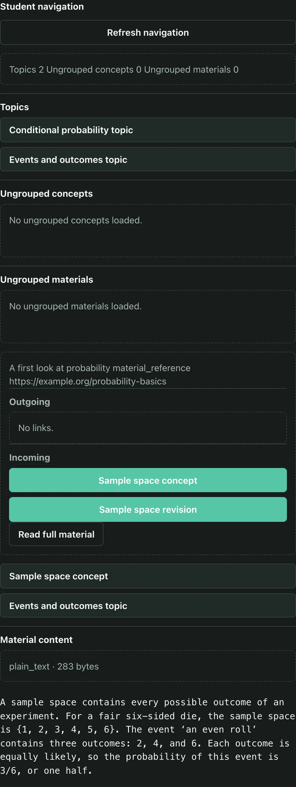
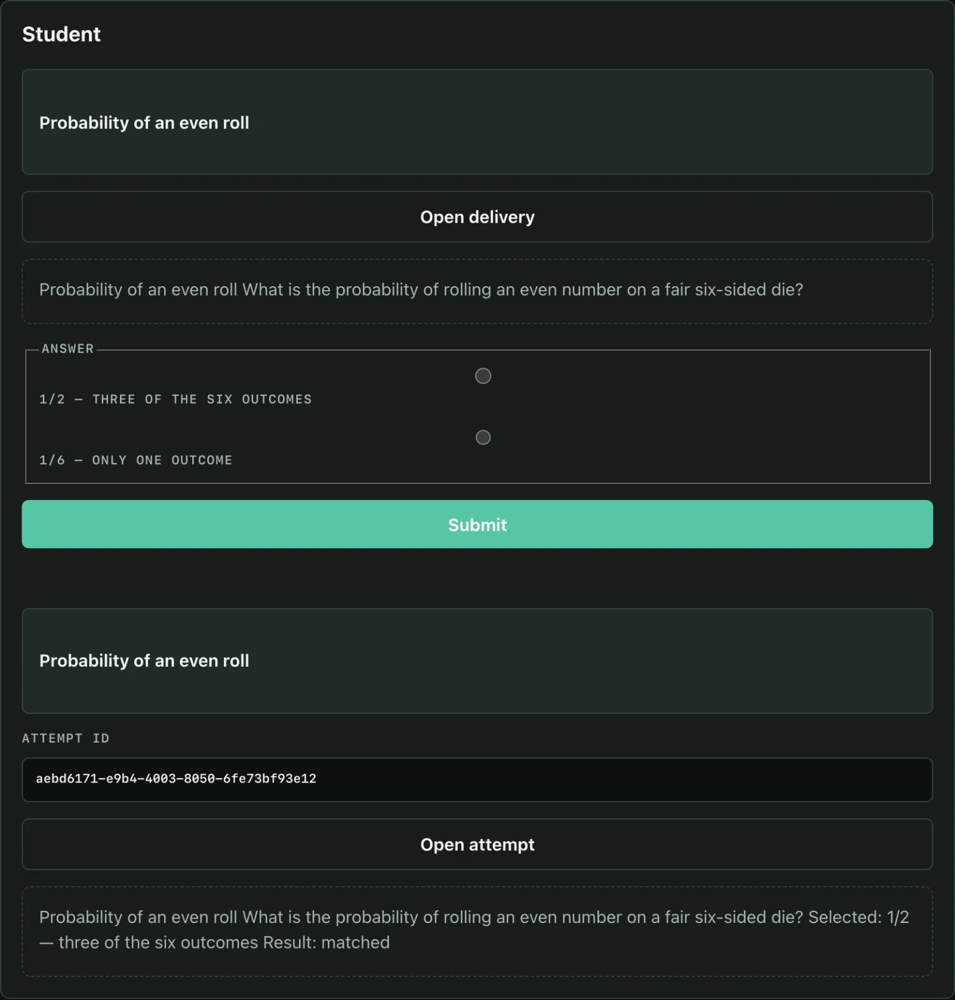
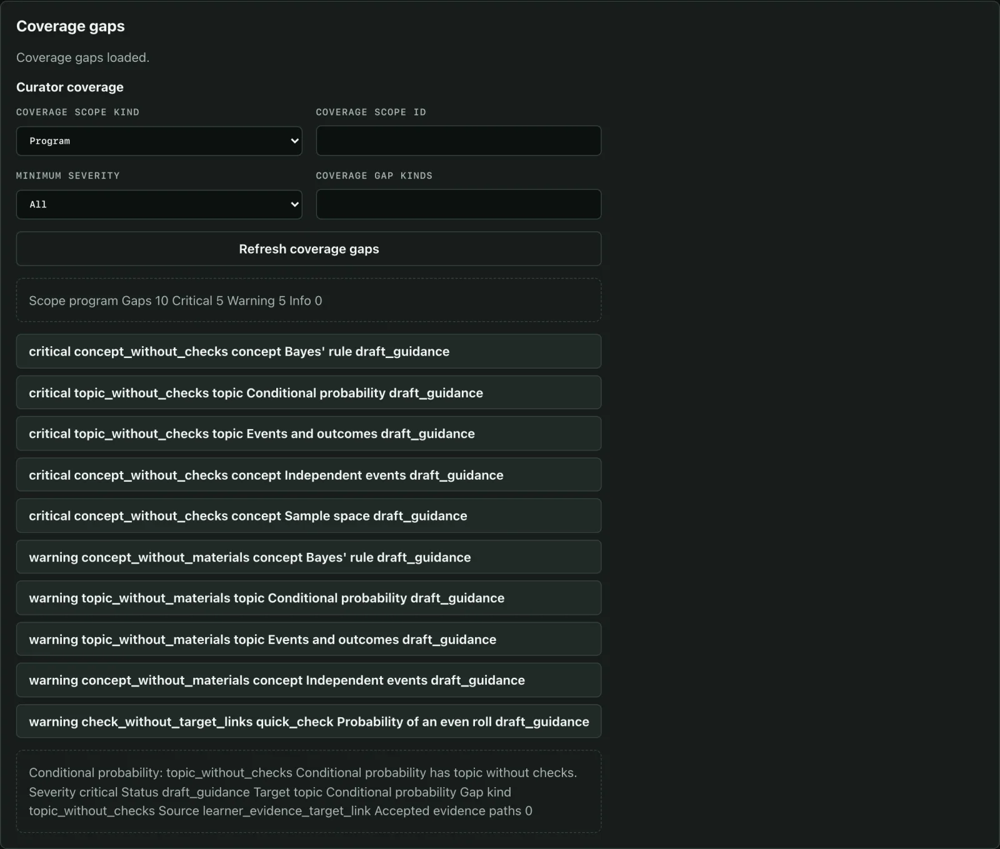
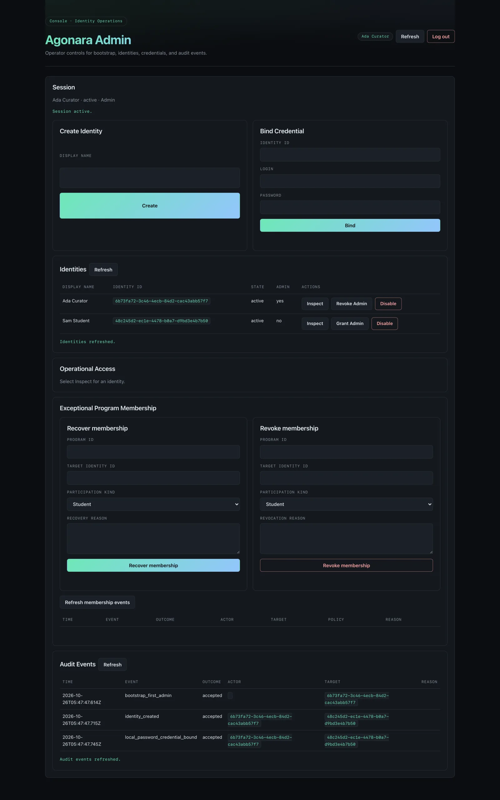
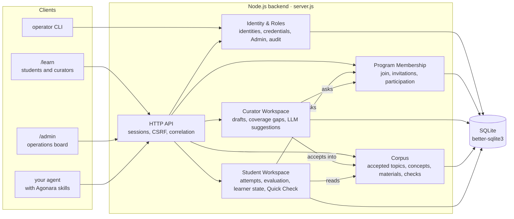

# Agonara

Agonara is a bring-your-own-agent environment for learning programs: it
turns scattered study into a structured program you can follow, revise and
prove you understand.

A Program Curator builds a program from sources: topics, concepts,
materials and the checks that test them. Students join it, read the
accepted material, answer checks and see where they are weak. Both point
the agent they already use (Claude Code, Codex or any other) at their
Agonara instance; the agent drafts, quizzes and evaluates, but only a
person accepts program content. The agent skills are published at
[igor1309/agonara-skills](https://github.com/igor1309/agonara-skills).

The `/learn` and `/admin` web UIs, the operator CLI and the agents all use
the same HTTP API, described in [`docs/api/openapi.yml`](docs/api/openapi.yml).

| A student reads a program | and answers a Quick Check |
|---|---|
|  |  |

The curator sees what the program still lacks, and the Admin manages the
instance:





The screenshots show a demo program seeded through the API.

## How it is built



Each module owns its own state and does not reach into another's:

- accepted program content lives in the Corpus; curator drafts and LLM
  suggestions stay in the Curator Workspace until a curator accepts them;
- a student's answers, attempts and progress belong to the student and are
  never changed by a change to the program;
- Program Membership decides who takes part; other modules ask it rather
  than read its rules;
- Admin is an operational role for the instance, not a learning role, and
  does not own program content.

Everything is in one SQLite file, and every module takes part in backup and
restore.

## Running it locally

You need Docker.

```sh
git clone https://github.com/igor1309/agonara.git
cd agonara
AGONARA_BOOTSTRAP_SECRET=choose-a-secret docker compose up --build
```

Open <http://127.0.0.1:18080/admin>, create the first Admin with the
bootstrap secret, then go to <http://127.0.0.1:18080/learn>.

Without Docker, with Node.js 22:

```sh
npm ci
npm test
AGONARA_BOOTSTRAP_SECRET=choose-a-secret AGONARA_DB_PATH=agonara.sqlite npm start
```

`npm start` listens on port 8080 unless `PORT` says otherwise. Without
`AGONARA_DB_PATH` the database is in memory and is gone when the server
stops.

Evaluating open answers needs a model behind an OpenAI-compatible
`/v1/chat/completions` endpoint, set with `AGONARA_NOMOS_BASE_URL`,
`AGONARA_NOMOS_API_KEY` and `AGONARA_NOMOS_MODEL`. Everything else runs
without one.

## Status

Agonara runs as a private instance at
[agonara.enoa.ai](https://agonara.enoa.ai). Identity, membership, corpus
curation, navigation, material reading, open-answer and Quick Check
assessment, learner state, readiness checks, coverage gaps and LLM-assisted
curation suggestions are implemented, with `/learn` screens for each.

The code is public to read. It is not open source: all rights reserved.
