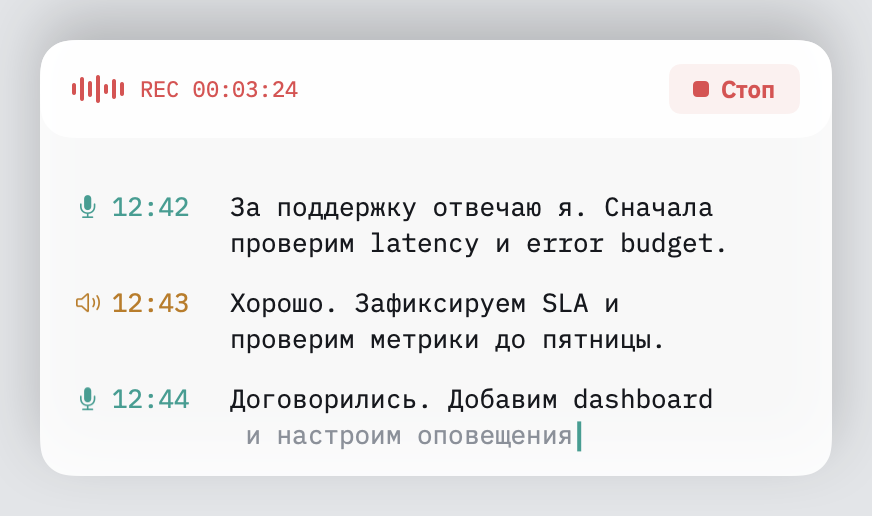
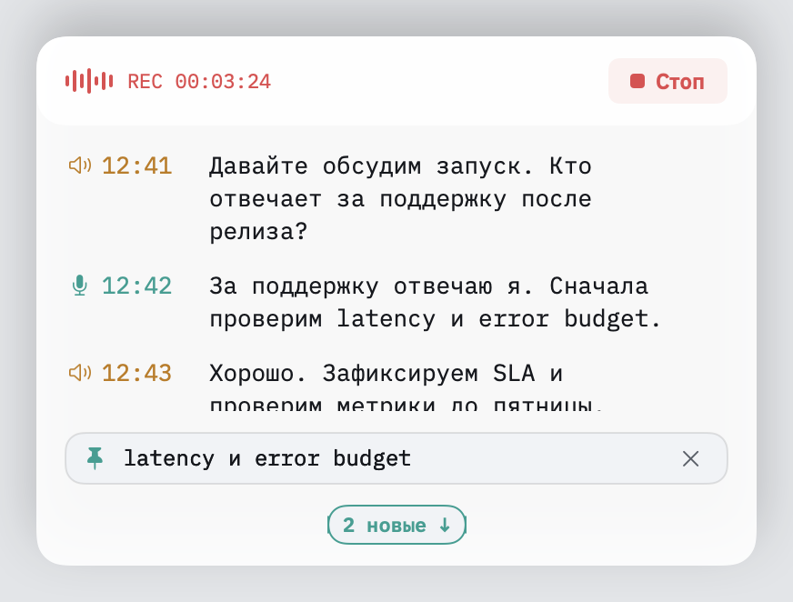
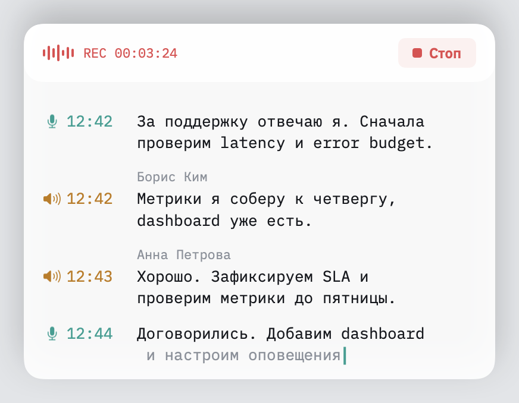

# Audelin

A native macOS call recorder with a floating, selectable live transcript.
Audio and speech recognition run locally. The interface is in Russian;
the transcript is designed for Russian conversations with English terms.



- Record microphone and call audio as separate tracks.
- Follow the live transcript with separate speaker symbols and timestamps.
- Select and hold a passage while the conversation continues.
- Scroll back without the viewport jumping; return to live text when ready.
- Resize the panel to fit beside a call window.
- Name remote speakers in Yandex Telemost calls live, with a browser extension.



The screenshots show the actual panel rendered with synthetic conversation
text, without recording a real call. This is an experimental app built from
source; there is no signed installer.

## Speaker names in Telemost

A Manifest V3 extension for Chrome and Yandex Browser reads a Telemost call
page's participant tiles and which one is marked as speaking. It reads no
audio, video or account data. Through the browser's native messaging it
reaches a helper inside the app, which relays to the running app over a
local socket. During a recording, a remote row takes the name of the person
shown speaking alone over most of it, drawn in grey italics as a live guess.
Without the extension, recording and transcription work as before and the
far side stays unnamed.



To use it, build and open the app once (below); at each launch it registers
its helper with Chrome and Yandex Browser. Then build the extension:

```sh
cd extension
npm ci
npm run build
```

Open `chrome://extensions` (or `browser://extensions` in Yandex Browser),
turn on developer mode, choose **Load unpacked** and pick `extension/dist`.
Its ID must be `boljabpcnipijdcdjjnmnpbfbdjjodkf`, fixed by the key in
`manifest.json`; the helper accepts only that ID. Join a call at
`telemost.yandex.ru/j/…` while Audelin records.

## Build and run

Requires Apple silicon, macOS 26 and Xcode 26 with Swift 6.2 or later.

```sh
cd macos
AUDELIN_SIGN_IDENTITY=- sh scripts/bundle.sh
open .build/Audelin.app
```

The command creates an ad hoc signed local app. Grant microphone and system
audio recording access in macOS when prompted. Speech models download on
first use; subsequent recognition runs on the Mac. Recordings are stored
in `~/Recordings/Audelin` by default.

## Tests

Both Swift packages build and test independently:

```sh
cd macos
swift build --build-tests
swift test
cd App
swift build --build-tests
swift test
```

Hardware and permission dependent tests may skip without access to audio devices.

The extension's tests read saved Telemost pages under jsdom:

```sh
cd extension
npm ci
npm test
```

## Code

`macos/Sources` holds the audio, recognition, recording and UI components.
`macos/App/Sources/Composer` connects them; `macos/App/Sources/Audelin`
is the menu bar application. `extension` holds the browser extension,
and `macos/Sources/BrowserBridge` its side in the app. Speech recognition uses
[FluidAudio](https://github.com/FluidInference/FluidAudio); app composition
uses [swift-imrx](https://github.com/igor1309/swift-imrx).
Bundled fonts retain their own license notices.

MIT licensed; see [LICENSE](LICENSE).
