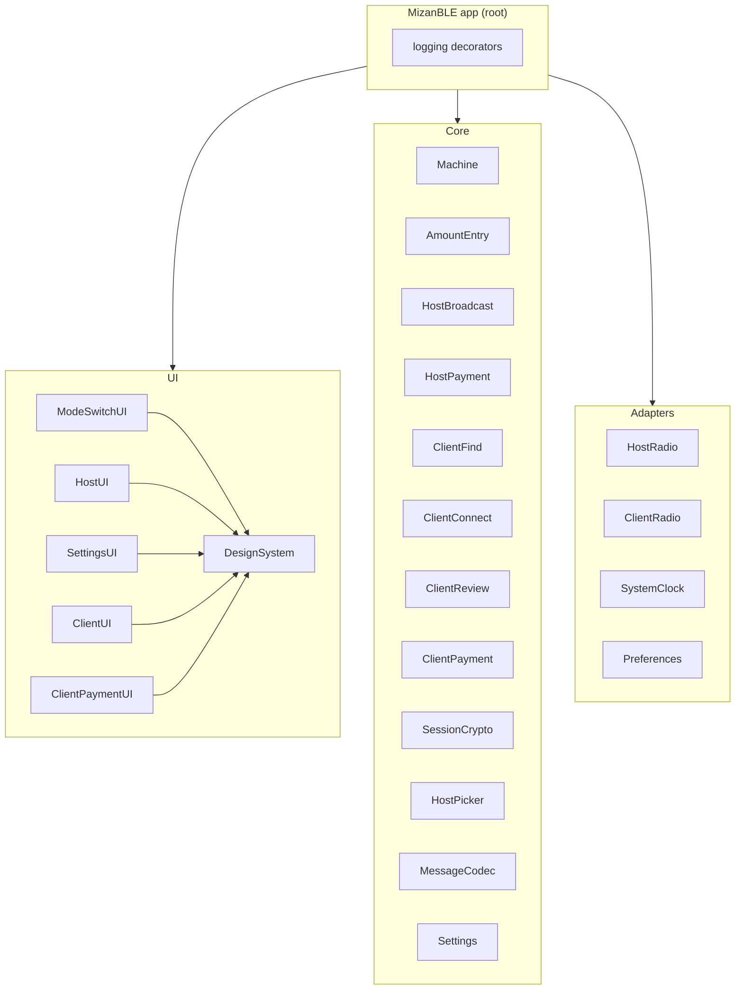

# Mizan BLE architecture

## Grounding

These rules hold for every line of Mizan BLE's code. Re-read them before
designing, specifying or building anything.

1. **A component owns the interfaces it depends on.** It declares each
   collaborator as an interface of its own, shaped by the role that
   collaborator plays for it. It never imports another component, a concrete
   implementation or another component's interface, so it changes only for
   its own reasons.
2. **The outside world lives only in adapters.** That covers Core Bluetooth,
   the clock, stored preferences and SwiftUI. A component knows none of
   them. CryptoKit is a library of pure functions here: nothing is kept in
   the Keychain, so it needs no adapter.
3. **Each component owns its types.** There is no shared domain module. The
   host and the client each have their own amount, step and outcome; the
   composition root translates between them and the codec's types.
4. **Only the composition root knows concrete pieces.** It builds every
   component and adapter and decides what answers each interface. It
   decides nothing else: coordination that decides anything is a state
   machine with its own tests, and the root only builds and subscribes.
5. **Cross-cutting concerns are decorators at the root.** Logging wraps the
   radios' events, the messages sent and received and each machine's state.
   No component logs.

## Shape

Each side's transaction is a chain of state machines in the owner's
reducer and effect handler pattern, as in audelin. On the host, amount
entry types the amount, host broadcast takes it to a secure link and host
payment to a result. On the client, client find chooses the host, client
connect opens a secure link and reads the amount, client review takes the
payer's decision, and client payment waits for the result.

At each hand-over the root builds the next machine with what the last one
handed over (a host, or a link with its session). The machine that started
the transaction (host broadcast, client find) is not ended: it waits in a
handed-over state, and the root forwards the transaction's end to it, so
it goes back to its start. A machine in the middle (client connect, client
review) is done once it hands over, and the root ends it. Only the root
knows the chain; no machine knows the next.

| Part | What it is | How it is tested |
|---|---|---|
| Reducer | A pure function: `(State, Event) -> (State, Effect?)` | Tables of event in, state and effect out |
| Effect handler | Reads the effect, hands it to the one dependency given for it, and turns the result into an event. It decides nothing | Fakes behind its dependencies |
| Machine | The generic loop: takes events one at a time, reduces, publishes the state, runs the effect and feeds its result back in | Once, generically |

A reducer never does I/O. When a choice depends on state, the reducer makes
it and names it in the effect. A sequence is the reducer's too: each step is
one effect, and its result comes back as the event for the next step.

Each machine's events come from several sources (the screen, the radio, the
clock, its own effects). A thin, pure merge mapping in the root turns each
source's stream into the machine's events; no source knows the machine.

The UI modules draw a machine's state and send its user events. They decide
nothing; what a screen offers follows from the state.

## Components

| Component | Module | Kind | Responsibility |
|---|---|---|---|
| Machine | `Machine` | Core | The generic reducer and effect loop |
| Amount entry | `AmountEntry` | Core | The keypad's amount and whether it can be locked |
| Host broadcast | `HostBroadcast` | Core | The host from a locked amount, through the countdown and handshake, to a secure link |
| Host payment | `HostPayment` | Core | The host from a secure link, through the client's decision and the mock outcome, to a result |
| Client find | `ClientFind` | Core | The client from scanning, through the picker's choice, to the payer's start |
| Client connect | `ClientConnect` | Core | The client from a chosen host, through the handshake, to a secure link and the amount |
| Client review | `ClientReview` | Core | The client from the amount, through the payer's decision, to the host's acknowledgement |
| Client payment | `ClientPayment` | Core | The client from an acknowledged confirm to the host's result |
| Session crypto | `SessionCrypto` | Core | One transaction's keys, sealing, opening and replay check |
| Host picker | `HostPicker` | Core | Choosing the nearest host from timestamped signal readings |
| Message codec | `MessageCodec` | Core | The bytes of each message and of the session characteristic |
| Settings | `Settings` | Core | The settings, their defaults and allowed values |
| Design system | `DesignSystem` | UI | Tokens generated from the design, and its components as SwiftUI views |
| Host UI | `HostUI` | UI | The host's screens, drawn from the host machines' state |
| Settings UI | `SettingsUI` | UI | The host's settings sheet, opened from the gear |
| Client UI | `ClientUI` | UI | The client's find and connect screens, drawn from client find's and client connect's state |
| Client payment UI | `ClientPaymentUI` | UI | The client's review and result screens, drawn from client review's and client payment's state |
| Mode switch | `ModeSwitchUI` | UI | The header switch between host and client, the chosen mode, and the shell around its screens |
| Host radio | `HostRadio` | Adapter | Core Bluetooth peripheral: serving and retiring the service, advertising, the client's writes and subscription |
| Client radio | `ClientRadio` | Adapter | Core Bluetooth central: scanning, connecting, reading, writing, notifications |
| Clock | `SystemClock` | Adapter | Now, and ticks every interval asked for, until stopped |
| Preferences | `Preferences` | Adapter | The settings' stored values in `UserDefaults` |
| App | `MizanBLE` (app target) | Root | Builds everything, wires each interface, decorates with logging |

All modules but the app target live in one Swift package under
`mizan-ble/ios/`. The app targets iOS 17. The UI modules depend on `DesignSystem` only; that is the
one dependency between modules, since a design system is a library the
screens are drawn in, not a collaborator.

The root is the only node with outgoing arrows to components: no core,
adapter or UI module imports another, except the UI modules' use of
`DesignSystem`.

## Data flow

- **Host:** the host UI sends key presses to amount entry, lock, cancel
  and broadcast again to host broadcast, and the mock outcome, cancel and
  new amount to host payment. Their effects open and close a session
  (session crypto); serve, advertise, stop advertising and retire the
  service, or finish it after what is queued (host radio; a serve waits
  for a finish, and a mode switch finishes, never retires); start and stop
  the countdown (clock); and send a message (codec, then session crypto,
  then the host radio). The host radio's client key and decision writes,
  its subscription and unsubscription come back as events, the decision
  opened by session crypto and decoded by the codec on the way.
- **Client:** the client radio's scan readings, with the clock's ticks, go
  through the host picker; its answer (a host, hold closer, none) is the
  client find's event. Client connect's effects connect, read the
  session and write the key, client review's send the decision, and each
  end disconnects, through the client radio, with session crypto and the
  codec between them as on the host.
- **Bluetooth lost:** each radio reports it to the flow holding a link as
  that link dropped, so the flows have one loss to handle. Amount entry
  and client find hear Bluetooth's state, and offer no new attempt until
  it is back.
- **Mode:** the mode switch says which mode is on. The root keeps only that
  mode's flows and radio alive, and tells the switch whether they are at
  rest, which is when the switch may move.

## GATT layout

One primary service, `2B9C41A0-3990-45C8-8334-2A1760EC2EF0`, served by the
host and found by the client through a scan filtered on that UUID. The host
advertises the service UUID and its advertised name (`MIZAN-7F3A`).

| Characteristic | UUID | Properties | Host | Client |
|---|---|---|---|---|
| Session | `5AF4FD78-A9BD-4831-9E32-AB7C524B5025` | read | serves | reads |
| Client key | `3BE0A31F-A0AD-4BE6-B1F8-FCD73973F34C` | write | receives | writes |
| To client | `760B00DB-3591-4F2F-9352-D74A127CB218` | notify | sends | subscribes |
| To host | `15B7A4C5-0B45-4B5B-BAC8-08BACE8C7C1B` | write | receives | writes |

Writes are with response, so the writer learns each write arrived. The
session holds the host's compressed P-256 public key and the session id;
every message on To client and To host is a sealed message frame. The
bytes of each are the message codec's.

The order of one transaction:

1. The host locks the amount: it makes a session, serves the service and
   advertises. Its countdown starts.
2. The client's picker chooses the host; the payer starts the handshake.
   The client connects, discovers the service, subscribes to To client and
   reads Session.
3. The client writes its public key to Client key. The host stops
   advertising, keeping the service for that client. Both sides derive the
   session key; the host sends the amount on To client and stops its
   countdown once the radio has taken it.
4. The client opens the amount and shows it. The payer confirms or
   declines; the client writes the decision to To host.
5. The host opens the decision and acknowledges it on To client. On a
   decline, the transaction ends on both sides.
6. On a confirm, the host's operator picks the mock outcome; the host sends
   the result on To client. The client disconnects, and the host finishes
   the service: it sends what is queued, then removes it.

If the operator cancels before a decision counts, the host sends a sealed
end message on To client, then finishes the service. A peripheral cannot
disconnect a central, so the host ends a link by retiring the service; the
client sees it go. A transaction ends on either side when the link drops:
the client sees a disconnect or the service go, the host sees To client
unsubscribed.

## Settings

| Setting | Default | Allowed | Where it is set |
|---|---|---|---|
| Countdown | 60 s | 15, 30, 60, 90, 120 s | Settings UI |
| Picker α | 0.3 | 0.05 to 1 | No screen in v0.0.1 |
| Picker window | 1 s and 5 readings | 0.5 to 5 s, 1 to 20 readings | No screen in v0.0.1 |
| Picker floor | −65 dBm | −100 to −30 dBm | No screen in v0.0.1 |
| Picker margin | 6 dB | 0 to 20 dB | No screen in v0.0.1 |
| Picker fade | 2 s | 0.5 to 10 s | No screen in v0.0.1 |
| Advertised name | `MIZAN-` and 4 random hex digits, made once | read-only | Shown in the settings UI |

The picker's values are starting guesses (`NOTES.md`); the values measured
between a real iPad and iPhone replace the defaults. A stored value outside
its range reads as the default.

## Specs

Each component has a folder under `docs/spec/` with its `SPEC.md` and
`QA.md`; `docs/spec/SPEC.md` is the user's. The rules for writing them are
in `AGENTS.md`.

## Decided

Each line can be overturned by the owner.

- **Audelin's reducer and effect pattern for the flows,** because they
  are sequences of steps with waits and failures in between, which tables
  of events test without a radio.
- **A chain of machines per side,** split where a spec would pass 100
  lines and where the work changes: typing, broadcasting and paying on the
  host; finding, connecting, deciding and paying on the client. The secure link is
  where the countdown and the picker stop mattering.
- **The machine that started a transaction waits rather than ends,** so
  the root needs no state of its own to know where to go back to after it.
- **The root's wiring decides nothing:** each handed-over state has
  exactly one next machine and each end one machine to tell, so the
  mapping is fixed; whether a side is at rest is read off its machines'
  states. A choice between outcomes is always a reducer's.
- **The host picker and session crypto are components, not parts of a
  flow,** so each is tested on its own with no radio, as `NOTES.md` asks.
- **Two radio adapters, one per role,** because the host is only ever a
  peripheral and the client only a central; neither knows the other's API.
- **The GATT layout lives here,** not in one spec, since both radios and
  the codec answer to it.
- **The mode is chosen in the UI and kept by the root,** since choosing
  which flows run is building, and a switch held until they are at rest
  needs no machine of its own.
