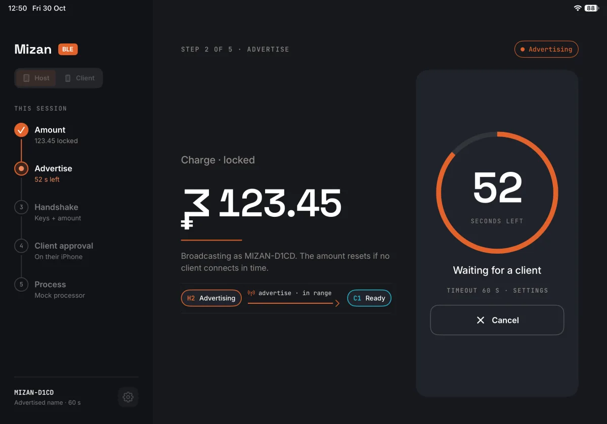
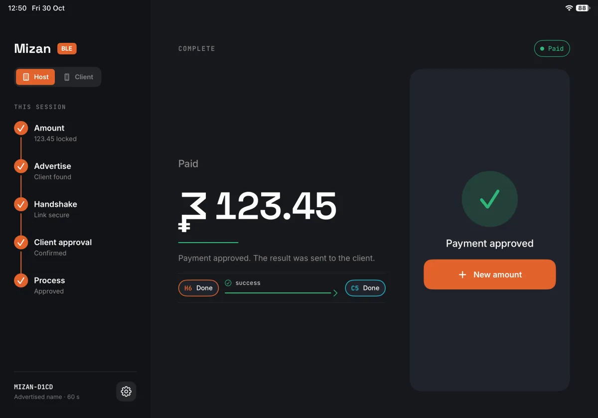
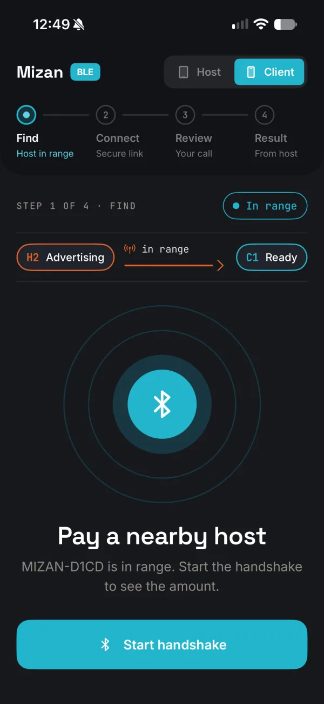
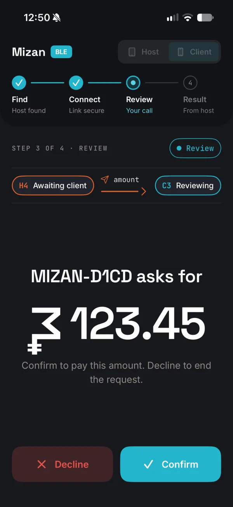
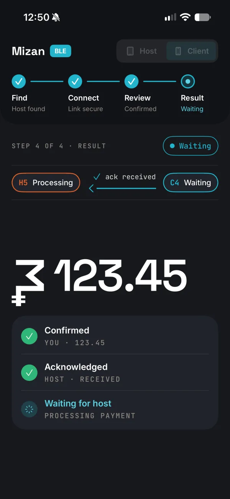
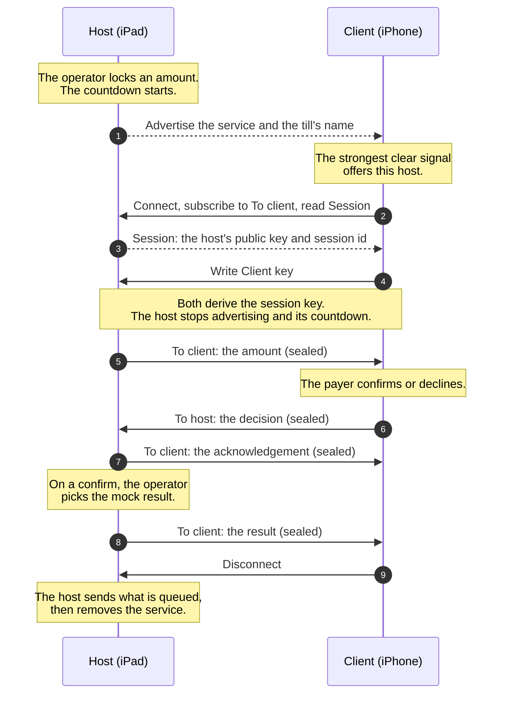

# Mizan BLE

Pay in Mizan between two iOS devices over Bluetooth Low Energy. One app has
two modes: the **host**, an iPad at the till, locks an amount and
advertises it; the **client**, an iPhone, finds the nearest host, shows the
amount, and the payer confirms or declines. The host shows the payment's
result, and both sides end the transaction.

**This is a proof of concept, not a payment system.** The payment is
mocked: on a confirm, the host's operator picks success or failure, and no
money moves. It was built to learn how far a phone-to-tablet payment can
go over Bluetooth on iOS: how the payer's phone picks the right till, and
how to keep the amount and the decision off the air in the clear.

Version 0.0.1 runs on a real iPad and iPhone: payments confirm, fail and
decline end to end, and a host left alone times out after its countdown.

| | |
|---|---|
|  |  |

| | | |
|---|---|---|
|  |  |  |

## How a payment goes

The host is a Bluetooth peripheral that serves one service and advertises
it with the till's name. The client is a central: it scans for that
service and picks the host by signal strength.



The service has four characteristics:

| Characteristic | Properties | Carries |
|---|---|---|
| Session | read | the host's public key and the session id |
| Client key | write | the client's public key |
| To client | notify | the amount, the acknowledgement, the result, or an end on cancel |
| To host | write | the payer's decision |

If no client connects before the countdown runs out, the host stops
advertising, removes the service and returns to the keypad.

### Picking the till

The client reads each host's signal strength (RSSI) for a moment and
smooths it with an exponential average. It offers a host only when the
host is strong enough to be within arm's reach and clearly stronger than
any other; otherwise it asks the payer to hold the phone closer. Once
offered, a host is held through short dips in signal, so the screen does
not flicker between answers.

RSSI is a convenience, not proof of distance or identity: on the devices,
the average moved 5 to 13 dB a second with the phone held still.

### Encrypting each exchange

The amount, the decision and the result never cross the air in the clear,
and a message from one transaction is useless in another.

- Each transaction makes a fresh P-256 key pair on both sides and a random
  16-byte session id on the host; nothing is kept after it ends.
- Both sides run ECDH and derive a 256-bit key with HKDF-SHA256, salted
  with the session id.
- Every message after the handshake is sealed with AES-GCM. The
  authenticated data binds the session id, the message type and a counter
  per direction, so a receiver rejects a wrong session, a replay, or
  anything after its session closed.
- The largest frame, the amount, is 41 bytes, so no message is fragmented.

The key keeps out a listener, not a fake till: any device can advertise as
a host. A later version could show the same four digits, derived from the
shared key, on both screens for the payer to compare.

## How it is built

- Swift 6.2, SwiftUI, Core Bluetooth and CryptoKit, iOS 26. One universal
  app; iPad launches as host, iPhone as client, and either can switch.
- A Swift package of small modules. Each flow is a state machine: a pure
  reducer and an effect handler with its collaborators injected, run on
  [swift-imrx](https://github.com/igor1309/swift-imrx)'s
  `ObservableModel`. No flow imports Core Bluetooth or CryptoKit; the
  radios, the clock and settings are adapters behind interfaces the flows
  own.
- The screens are UI modules on a design-system module, with macOS
  preview apps (`ios/PreviewApps`) that show each module's states.
- A rehearsal app, the `MizanBLE Rehearsal` scheme, runs the real app
  against a scripted other side read from a JSON file, since the simulator
  has no Bluetooth. Fifteen Maestro lanes in [`maestro/`](maestro/) drive
  it through every scenario and check the app's log, including that no
  amount, key or identifier is ever logged.
- 389 Swift Testing tests in 36 suites, run with `swift test` in `ios/`
  and `ios/App/`.
- Screen snapshot tests render the host on an 11-inch iPad and both sides
  on an iPhone 15 Pro, in light and dark, with each device's safe area.
- Built with AI coding agents working from specs and tests.

## Running it

```sh
cd ios
swift build
swift test
cd App
swift test
```

Open `ios/App/MizanBLE.xcodeproj` in Xcode 26, choose the `MizanBLE`
scheme and run it on an iPad and an iPhone. Bluetooth needs real devices;
signing is off in the project, so set your own team to run on a device. To
try it on a simulator, run the `MizanBLE Rehearsal` scheme; its settings
format and examples are in
[`ios/App/Rehearsal/README.md`](ios/App/Rehearsal/README.md).

## About this repository

This is a published snapshot of a project developed in a private monorepo.
Issues are welcome; pull requests may not be merged here.

## License

[MIT](LICENSE)
