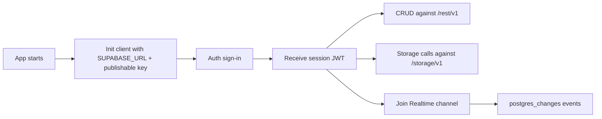

# Minimal Thin Clients for Supabase

## Executive summary

If you need one thin client that cleanly covers **Auth + Database + Storage + Realtime** without framework assumptions, the best overall choice is **`@supabase/supabase-js`**. It is the primary official JavaScript/TypeScript SDK, works in browsers and Node, exposes one coherent API surface, and avoids the session/header plumbing you must do when you compose lower-level packages or call the raw APIs directly. Supabase’s own docs list JavaScript/TypeScript and Python as official client libraries; Go is community-supported, and the community matrix does **not** show a full bundled Rust client. citeturn27search0turn36search2turn31search1

If your only priority is the **absolute thinnest possible abstraction**, the real minimum is **no Supabase SDK at all**: call `/auth/v1`, `/rest/v1`, `/storage/v1`, and the Realtime WebSocket directly. That is the best fit for **Rust** and for extremely size-sensitive backend services, but it is materially more complex because you must manage headers, bearer tokens, publication setup, and the Phoenix-style Realtime protocol yourself. Supabase explicitly describes its REST layer as a “very thin API layer on top of Postgres,” and its Realtime docs publish the raw WebSocket protocol and `phx_join` payload format. citeturn18view2turn37search0turn19search0

For **Python**, the official choice is **`supabase-py`**. It is thin and ergonomic for Auth/DB/Storage, but Realtime requires the **asynchronous** client, which makes it slightly less minimal in practice than the JavaScript SDK. Supabase’s feature-status page also marks the Python client library as **beta**, while the JavaScript client is GA. citeturn13view4turn13view8turn27search3

## Scope and evaluation criteria

I prioritized: official support first, then minimal community wrappers; coverage of **auth, database, storage, realtime**; smallest practical client surface; setup friction; and whether the package keeps session state and headers consistent across services. I used official docs, official repository/package pages, and registry metadata for size signals. Bundle-size data is uneven: for JavaScript, published browser-bundle figures are available for `supabase-js`; for the other packages, the most reliable public signals I found were npm “unpacked size” or PyPI wheel sizes, which are useful for comparison but are **not** the same thing as final browser transfer size. citeturn6search5turn7search5turn29search2turn21search0turn28search2turn22search0turn10view1turn12view0turn12view1

For Realtime examples, I use **Postgres Changes** because it is the simpler thin-client path. Supabase recommends **Broadcast** for better scalability and security, but Postgres Changes requires less application-side setup and is easier to show in a minimal report. New projects disable database-change listening by default, so you must enable replication/publication for the table you want to watch. citeturn18view0turn18view1turn38search0turn38search2

## Comparison table

| Candidate | Support | Coverage | Size signal | Complexity | Summary |
|---|---|---|---|---|---|
| `@supabase/supabase-js` | Official | Auth, DB, Storage, Realtime | **41.7 kB min+gzip** on Bundlephobia for published v2.80.0; npm package page shows current published v2.103.3 | Low | Best overall thin client if you need all four services in one place. citeturn6search5turn7search5turn36search2 |
| Official modular JS stack: `@supabase/auth-js` + `postgrest-js` + `storage-js` + `realtime-js` | Official low-level packages | Full coverage if you compose all four yourself | npm unpacked sizes: **auth-js 1.02 MB**, **postgrest-js 369 kB**, **storage-js 300 kB**, **realtime-js 466 kB**; no single combined min+gzip figure surfaced cleanly from primary package pages | Medium to high | Good only when you truly want to cherry-pick services; worse simplicity if you need all four anyway. citeturn29search2turn21search0turn28search2turn22search0turn36search2turn34search5 |
| `supabase-py` | Official | Auth, DB, Storage, Realtime | PyPI wheel sizes: **supabase 16.6 kB**; related published wheels include **realtime 22.4 kB** and **storage3 28.2 kB** | Medium | Best Python choice, but Realtime being async-only makes it less minimal operationally. citeturn10view1turn12view0turn12view1turn27search3 |
| Raw REST + Realtime protocol | Official protocols, no SDK | Auth, DB, Storage, Realtime | **0 Supabase SDK bytes**; only your HTTP/WebSocket client | High | Best for Rust and for ultra-thin backend services; worst ergonomics. citeturn18view2turn19search0turn37search0turn9view2 |
| Go community libraries | Community | Practical coverage exists, but support is community-only | No browser bundle; server-side module only | Medium | Worth considering in Go, but not my first recommendation over JS or raw protocols. citeturn27search0turn30search0turn30search3 |

## Official first-choice options

### `@supabase/supabase-js`

This is the strongest default because it keeps the whole flow in one client: project URL + publishable key, user sign-in, PostgREST CRUD, Storage methods, and Realtime channels all share the same session model. The JS monorepo explicitly lists `@supabase/supabase-js` as the main SDK and the other packages as internal constituent libraries. Supabase’s JavaScript reference says the client covers database access, auth, large-file management, and realtime events. citeturn36search2turn13view0

**Purpose and API surface.** Use it when you want one coherent client for everything. The key APIs are `createClient`, `supabase.auth.signInWithPassword`, `supabase.from(...).insert/select/update/delete`, `supabase.storage.from(...).upload/download/list`, and `supabase.channel(...).on(...).subscribe()`. On server-side runtimes, Supabase documents a server-oriented auth config with `persistSession: false`, `autoRefreshToken: false`, and `detectSessionInUrl: false`. citeturn17search3turn16search7turn17search1turn17search5turn38search2turn17search6

**Setup and environment.** Minimum env vars are `SUPABASE_URL` and a publishable or anon key. Supabase’s API-key guide says **publishable keys** are safe to expose in browser/mobile code, while **secret keys** are backend-only and bypass RLS. For Postgres Changes, add the table to the `supabase_realtime` publication and enable the relevant replication setting. citeturn18view3turn18view1turn38search2

The minimal example below uses password auth, full CRUD on a `todos` table, and a Realtime subscription. The documented methods and setup are cited here. citeturn17search3turn16search7turn17search1turn17search5turn38search2turn18view1

```ts
import { createClient } from '@supabase/supabase-js'

const supabase = createClient(
  process.env.SUPABASE_URL!,
  process.env.SUPABASE_PUBLISHABLE_KEY!,
  {
    // For Node/server usage, prefer false/false/false here.
    auth: { persistSession: typeof window !== 'undefined' },
  }
)

async function demo() {
  const { error: authError } = await supabase.auth.signInWithPassword({
    email: process.env.DEMO_EMAIL!,
    password: process.env.DEMO_PASSWORD!,
  })
  if (authError) throw authError

  const { data: created, error: createError } = await supabase
    .from('todos')
    .insert({ task: 'thin client review', done: false })
    .select()
    .single()
  if (createError) throw createError

  const { data: readBack, error: readError } = await supabase
    .from('todos')
    .select('*')
    .eq('id', created.id)
    .single()
  if (readError) throw readError

  const { error: updateError } = await supabase
    .from('todos')
    .update({ done: true })
    .eq('id', created.id)
  if (updateError) throw updateError

  const channel = supabase
    .channel('todos-live')
    .on(
      'postgres_changes',
      { event: '*', schema: 'public', table: 'todos' },
      (payload) => console.log('realtime change:', payload)
    )
    .subscribe()

  const { error: deleteError } = await supabase
    .from('todos')
    .delete()
    .eq('id', created.id)
  if (deleteError) throw deleteError

  console.log('readBack:', readBack)
  return channel
}

demo().catch(console.error)
```

**Pros.** Lowest cognitive load; official; works in browser and Node; best session consistency; strongest docs. **Cons.** If you only need one or two products, the umbrella package may pull more surface area than necessary. License: **MIT**. Primary sources: JavaScript reference, monorepo, package page, bundle-size listing. citeturn13view0turn36search2turn7search5turn6search5

### Official modular JavaScript packages

This path is theoretically thinner because you can install only what you use: `@supabase/auth-js` for Auth, `@supabase/postgrest-js` for the database REST API, `@supabase/storage-js` for Storage, and `@supabase/realtime-js` for channels. Supabase’s JS monorepo explicitly lists those packages. The trade-off is that once you need **all four**, you lose most of the ergonomic benefit because you must wire URLs, headers, and session propagation yourself. Supabase also moved the standalone repositories into the JS monorepo, which is another signal that the all-in-one client is the expected default. citeturn36search2turn34search5

**Purpose and API surface.** `AuthClient` for `signUp/signInWithPassword/signOut`; `PostgrestClient` for `from().select/insert/update/delete`; `StorageClient` for `from().upload/download/list`; `RealtimeClient` for `channel().on().subscribe()`. Current package pages show these as distinct packages with small dependency graphs, but the composition burden is yours. citeturn29search2turn21search0turn28search2turn22search0

**Setup and environment.** You still need `SUPABASE_URL` and a publishable/anon key; for requests that should act as the signed-in user, you must propagate the session access token into the `Authorization` header and, for Realtime, into the channel join/auth flow. If you do not need user-specific RLS in the demo, the publishable key is enough to keep the sample small. citeturn18view3turn18view4turn37search0

The example below stays intentionally minimal and uses the publishable key for the basic flow; that is fine for an RLS policy that allows the operations shown, but it is exactly the sort of manual session handling that makes this stack less attractive than `supabase-js` when you need all four services. citeturn29search2turn21search0turn28search2turn22search0turn37search0

```ts
import { AuthClient } from '@supabase/auth-js'
import { PostgrestClient } from '@supabase/postgrest-js'
import { StorageClient } from '@supabase/storage-js'
import { RealtimeClient } from '@supabase/realtime-js'

const url = process.env.SUPABASE_URL!
const key = process.env.SUPABASE_PUBLISHABLE_KEY!

const commonHeaders = {
  apikey: key,
  Authorization: `Bearer ${key}`,
}

const auth = new AuthClient({
  url: `${url}/auth/v1`,
  headers: commonHeaders,
})

const db = new PostgrestClient(`${url}/rest/v1`, { headers: commonHeaders })
const storage = new StorageClient(`${url}/storage/v1`, commonHeaders)
const realtime = new RealtimeClient(
  `${url.replace(/^http/, 'ws')}/realtime/v1`,
  { params: { apikey: key } }
)

async function demo() {
  const { error: authError } = await auth.signInWithPassword({
    email: process.env.DEMO_EMAIL!,
    password: process.env.DEMO_PASSWORD!,
  })
  if (authError) throw authError

  const { data: created, error: createError } = await db
    .from('todos')
    .insert({ task: 'modular thin client review', done: false })
    .select()
    .single()
  if (createError) throw createError

  const { data: readBack, error: readError } = await db
    .from('todos')
    .select('*')
    .eq('id', created.id)
    .single()
  if (readError) throw readError

  const { error: updateError } = await db
    .from('todos')
    .update({ done: true })
    .eq('id', created.id)
  if (updateError) throw updateError

  realtime
    .channel('todos-live')
    .on('postgres_changes', { event: '*', schema: 'public', table: 'todos' }, (payload) => {
      console.log('realtime change:', payload)
    })
    .subscribe()

  const { error: deleteError } = await db
    .from('todos')
    .delete()
    .eq('id', created.id)
  if (deleteError) throw deleteError

  // Example storage surface:
  // await storage.from('assets').upload('hello.txt', new Blob(['hello']))
  console.log(readBack)
}

demo().catch(console.error)
```

**Pros.** Smallest *conceptual* stack when you only need one concern. **Cons.** If you need Auth + DB + Storage + Realtime together, complexity rises sharply; you now own session-token coordination and endpoint wiring. Licenses: **MIT** across these packages. Primary sources: package pages and JS monorepo. citeturn29search2turn21search0turn28search2turn22search0turn36search2

### `supabase-py`

This is the official Python client and the right answer for Python-first applications. Its strengths are a very small top-level wheel and an API that mirrors the JS concepts closely. Its main weakness for a “thin client” use case is that **Realtime only works with the async client** created via `acreate_client()`, so the simplest mental model is split: sync-friendly Auth/DB/Storage, async-only Realtime. Supabase’s docs say exactly that, and the feature-status page still marks the Python client library as beta. citeturn13view4turn16search10turn13view8turn27search3

**Purpose and API surface.** `create_client()` / `acreate_client()`, `supabase.auth.sign_in_with_password`, `supabase.table(...).select/insert/update/delete().execute()`, `supabase.storage.from_(...).upload/download/list`, and `supabase.channel(...).on_postgres_changes(...).subscribe()`. The package pages also show that `realtime` and `storage3` are published separately, which is a clue that the umbrella package is relatively thin and composes smaller pieces. citeturn16search10turn33search1turn13view6turn13view7turn38search0turn14search0turn14search7turn10view1turn12view0turn12view1

**Setup and environment.** Use `SUPABASE_URL` and `SUPABASE_KEY`, as shown in the Python docs. For Realtime Postgres Changes, enable replication/publication on the table first. citeturn16search10turn13view8turn18view1

A minimal, accurate Python pattern is to use the sync client for Auth/CRUD and the async client for Realtime. That split is the main reason I rank it below `supabase-js` for the “simplest thin client” title. citeturn16search10turn33search1turn38search0

```python
# auth + CRUD
import os
from supabase import create_client

supabase = create_client(
    os.environ["SUPABASE_URL"],
    os.environ["SUPABASE_KEY"],
)

supabase.auth.sign_in_with_password(
    {
        "email": os.environ["DEMO_EMAIL"],
        "password": os.environ["DEMO_PASSWORD"],
    }
)

created = (
    supabase.table("todos")
    .insert({"task": "python thin client review", "done": False})
    .execute()
)

todo_id = created.data[0]["id"]

read_back = (
    supabase.table("todos")
    .select("*")
    .eq("id", todo_id)
    .execute()
)

(
    supabase.table("todos")
    .update({"done": True})
    .eq("id", todo_id)
    .execute()
)

(
    supabase.table("todos")
    .delete()
    .eq("id", todo_id)
    .execute()
)

print(read_back.data)
```

```python
# realtime
import os
import asyncio
from supabase import acreate_client

async def main():
    supabase = await acreate_client(
        os.environ["SUPABASE_URL"],
        os.environ["SUPABASE_KEY"],
    )

    def handle_change(payload):
        print("realtime change:", payload)

    await (
        supabase.channel("todos-live")
        .on_postgres_changes("*", schema="public", table="todos", callback=handle_change)
        .subscribe()
    )

    await asyncio.sleep(60)

asyncio.run(main())
```

**Pros.** Official; small published wheels; good API parity with JS. **Cons.** Realtime async-only; official support status is not as mature as JS. License: **MIT**. Primary sources: Python reference and package pages. citeturn16search10turn13view4turn13view8turn10view1turn12view0turn12view1

## Community and protocol-level options

### Go and Rust reality check

The strongest non-official options today come from entity["organization","Supabase Community","open source org"]. Supabase’s own “Client Libraries” page lists **Go** as community-supported, not official. In the community matrix, **Rust** has only partial entries (`postgrest-rs`, `auth-rs`) and **no bundled full client**, no community Realtime entry, and no community Storage entry in that summary table, which is why I do **not** recommend chasing a unified Rust wrapper as your primary path. citeturn27search0turn31search1

For **Go**, the community `supabase-go` repository presents a bundled client with Auth, PostgREST, Storage, Realtime, and Functions, and it is MIT-licensed. That said, the lower-level community Auth client is explicitly marked **pre-release / work in progress**, which is a warning sign about maturity relative to the JavaScript and Python official clients. My recommendation for Go is therefore pragmatic: if you want convenience and do not mind community support, test `supabase-go`; if you want the thinnest, most durable integration surface, call the official HTTP/WebSocket APIs directly. citeturn30search0turn30search3

For **Rust**, the practical thin path is **raw official protocols**, optionally using `postgrest-rs` only for DB ergonomics. The `postgrest-rs` repository is actively documented, shows the needed `apikey` and `Authorization` headers for Supabase gateway/RLS use, and is dual-licensed MIT/Apache-2.0. citeturn31search0turn31search1

### Raw REST and Realtime protocol

This is the lowest-abstraction option and the one I would choose for **Rust**, or for back-end services where every dependency matters more than developer ergonomics. The core official surfaces are:

- **Auth:** `/auth/v1/signup`, `/auth/v1/token?grant_type=password` for password auth. citeturn19search0
- **Database:** `/rest/v1/` via PostgREST. Supabase describes it as a very thin layer over Postgres. citeturn18view2
- **Storage:** `/storage/v1`. The Python storage client docs show the canonical endpoint shape `https://<project>.supabase.co/storage/v1`. citeturn9view2
- **Realtime:** `wss://<project-ref>.supabase.co/realtime/v1/websocket?apikey=<API_KEY>` plus a `phx_join` message. citeturn37search0turn18view5

**Setup and environment.** Use `SUPABASE_URL`, a publishable key for client-safe use, and runtime user credentials if you need a user session. Supabase’s key docs say publishable keys are safe to expose online; secret keys are backend-only and bypass RLS. For Realtime Postgres Changes, you must enable replication/publication for the table. citeturn18view3turn18view1

The example below is plain JavaScript because it is easy to read, but the same shape maps directly to **Go** (`net/http` + a WebSocket client) or **Rust** (`reqwest` + a WebSocket client). The Realtime join payload is based on the published protocol. citeturn19search0turn18view2turn37search0

```js
const url = process.env.SUPABASE_URL
const key = process.env.SUPABASE_PUBLISHABLE_KEY
const email = process.env.DEMO_EMAIL
const password = process.env.DEMO_PASSWORD

async function demo() {
  // Auth
  const authRes = await fetch(`${url}/auth/v1/token?grant_type=password`, {
    method: 'POST',
    headers: {
      apikey: key,
      Authorization: `Bearer ${key}`,
      'Content-Type': 'application/json',
    },
    body: JSON.stringify({ email, password }),
  })
  const session = await authRes.json()
  const bearer = `Bearer ${session.access_token}`

  // Create
  const createRes = await fetch(`${url}/rest/v1/todos`, {
    method: 'POST',
    headers: {
      apikey: key,
      Authorization: bearer,
      Prefer: 'return=representation',
      'Content-Type': 'application/json',
    },
    body: JSON.stringify({ task: 'raw thin client review', done: false }),
  })
  const [created] = await createRes.json()

  // Read
  const readRes = await fetch(
    `${url}/rest/v1/todos?id=eq.${created.id}&select=*`,
    {
      headers: { apikey: key, Authorization: bearer },
    }
  )
  console.log(await readRes.json())

  // Update
  await fetch(`${url}/rest/v1/todos?id=eq.${created.id}`, {
    method: 'PATCH',
    headers: {
      apikey: key,
      Authorization: bearer,
      'Content-Type': 'application/json',
    },
    body: JSON.stringify({ done: true }),
  })

  // Realtime
  const projectRef = new URL(url).host.split('.')[0]
  const ws = new WebSocket(
    `wss://${projectRef}.supabase.co/realtime/v1/websocket?apikey=${key}&vsn=1.0.0`
  )

  ws.addEventListener('open', () => {
    ws.send(
      JSON.stringify({
        topic: 'realtime:todos-live',
        event: 'phx_join',
        payload: {
          config: {
            broadcast: { ack: false, self: false },
            presence: { enabled: false },
            postgres_changes: [{ event: '*', schema: 'public', table: 'todos' }],
            private: false,
          },
          access_token: session.access_token,
        },
        ref: '1',
        join_ref: '1',
      })
    )
  })

  ws.addEventListener('message', (event) => {
    console.log('realtime frame:', event.data)
  })

  // Delete
  await fetch(`${url}/rest/v1/todos?id=eq.${created.id}`, {
    method: 'DELETE',
    headers: { apikey: key, Authorization: bearer },
  })
}

demo().catch(console.error)
```

**Pros.** Zero Supabase SDK bytes; easiest to port to Rust or Go; maximally transparent. **Cons.** Highest complexity; you own token refresh, header consistency, Storage request details, and Realtime protocol mechanics. License: **N/A as a library choice**; this is an integration approach rather than a single SDK. The underlying documented platform and services are open-source, with the platform repository under Apache-2.0 and several client packages under MIT. citeturn30search6turn36search2

## Auth to query to realtime flow

Supabase’s documented request flow is: app initializes with project URL and key, performs Auth to get a user session JWT, uses that JWT against REST/Storage, and joins Realtime over WebSocket with the publishable key and optionally the user access token. For client SDKs, unauthenticated requests carry the API key; authenticated requests carry the user session token in `Authorization`. Realtime WebSocket connections use the API key as a query parameter. citeturn18view3turn18view4turn37search0



## Recommendation

For the problem exactly as stated — **simple**, **minimal**, supports **auth + database + storage + realtime**, no framework assumption, and prioritizes official support — my recommendation is:

**Final suggested thin client: `@supabase/supabase-js`**

Why this wins:

- It is the only option here that combines **all four services** with **official support** and a **single session model**. citeturn13view0turn36search2
- It avoids the manual composition burden of the modular JS packages. That burden only pays off when you truly use a subset of Supabase, not when you need auth + DB + storage + realtime together. citeturn29search2turn21search0turn28search2turn22search0
- It is materially simpler than `supabase-py` for realtime-heavy use because Python requires the async client for Realtime. citeturn13view8turn38search0
- It is much lower-friction than the raw protocol path while still staying relatively small for a full-featured SDK. citeturn6search5turn18view2turn37search0

Use the other paths only for these edge cases:

- **Choose modular JS packages** only if you decisively need just one or two Supabase products and want to squeeze scope manually. citeturn36search2turn34search5
- **Choose `supabase-py`** if Python is the non-negotiable language. citeturn13view4turn16search10
- **Choose raw REST + Realtime protocol** if your real goal is “smallest possible integration surface,” especially in **Rust** or ultra-thin back-end services. citeturn31search1turn18view2turn37search0