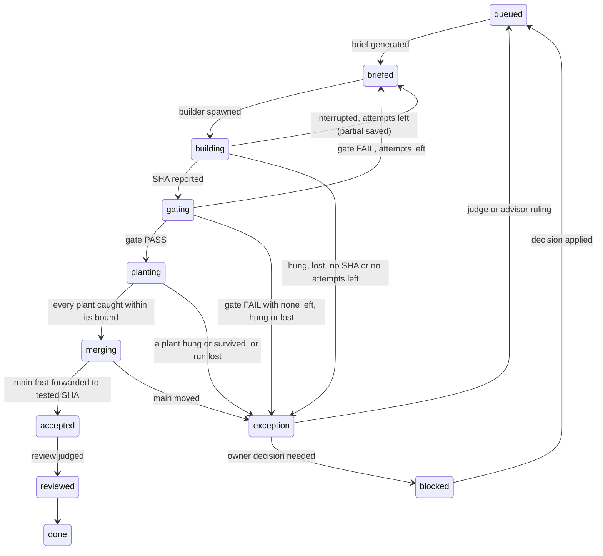

# The build-loop orchestrator, v3.3: `agister`

v3 turned v2's script (R1) into `agister`, a long-running local Go server that owns the state machine and every side effect.

v3.3 applies the adversarial review of v3.2 (A1–A12), two gaps found while checking it (G1, G2), and its own adversarial review (B1–B8). L- and R-numbers cite the lessons and earlier reviews.

## Concise

`agister` is one Go binary on the build machine. A lock enforces one instance per repo. It is the only writer of loop state.

- **State is an event log outside the repo.** Transitions append to `~/.agister/repos/<id>/events.jsonl`, and state is a fold over that log. `tracker.tsv`, `INBOX.md` and the review queue are generated views. Builders can't reach any of it.
- **Transitions are pure; effects are separate.** Transitions emit durable intents; workers report results as events. After a crash, open intents are reconciled first.
- **Agents are sandboxed subprocesses** (`claude -p`, `codex exec`) in disposable clones, with closed stdin, a hard timeout and a result schema. Output goes to a per-run file whose growth is the heartbeat.
- **Limits are scoped resources** (repo, machine or provider account). Exhaustion interrupts or holds work and never counts as a failure.
- **Observable, read-only:** a loopback dashboard, `/metrics` and `agister explain <step>`.
- **The owner acts through commands** over a Unix socket. Each INBOX item, incidents included, is pushed at least once.

What stays from v2: small steps, a fresh agent for every run, gates that decide, only a test rejects a finding, and nothing blocks the build.

## Detailed

### 1. Why a server

It rules out three v1 failure modes: an LLM holding orchestration state (L22), relayed self-reports (L20), and state lost to compaction (L23).

### 2. The model

| Entity | States |
|---|---|
| **Step** | `queued → briefed → building → gating → planting → merging → accepted → reviewed → done`, plus `exception` and `blocked` |
| **Run** | `requested → running → exited(code) \| hung \| lost \| interrupted(cause)` |
| **Review** | `queued → running → exited → judged`, or `interrupted → queued` |
| **Finding** | `open → row \| rejected(covered) \| proven-false \| closed(scope, dup)` |
| **Decision** | `open → answered → applied` |
| **Hold** | `active(reason, until?) → lifted` |

`closed` is administrative, not a rejection, so "only a test rejects a finding" holds (A8).



`merging` emits `Merge` (G1). An interrupted gate, plants or merge run reruns on the same SHA (B6). Interruptions skip `exception`, where a judge would spawn into the hold (L55). `main moved` goes to a judge on purpose: a rebase changes what was tested.

A transition is a pure Go function, `(State, Event) → (State, []Intent, error)`. Guards replace v1's script refusals (L11). For example, `briefed → building` is refused while another step is in `building` through `merging`, or the module tag is missing (L7). Steps in `exception` or `blocked` don't hold the queue; the next brief lists them as missing from its base (B3). Refusals are logged with their reason.

### 3. State and persistence

- **Location.** The log, views, run files, locks and socket live in `~/.agister/repos/<id>/`. Builder sandboxes deny `~/.agister/` (A1, A6, B1).
- **Write-ahead (B2).** An intent is appended and fsynced before its effect starts; a result is fsynced before anything acts on it.
- **History.** The state directory is its own git repo. At step boundaries and after owner commands, `agister` commits the log and views; run files stay local and rotate (B8). Back it up by pushing that repo.
- **Reserved paths.** A candidate SHA whose diff touches a reserved path is rejected before gating (A6).
- **Hand edits.** A view whose hash changed opens an incident and is regenerated.
- **Framing (A10).** Each line is one JSON object: `v` (schema version), `seq`, `ts`, entity, event, payload, cause. On open, a torn final line is truncated as an incident, a `seq` gap refuses start, and a duplicate intent result is dropped. A binary refuses newer `v`; old events are folded, never rewritten. Views are replaced by write-then-rename.
- **Replay.** `agister replay` rebuilds all state from the log alone. Anything read from shared machine or provider state is logged as an observation, so replay never consults it (B5).

### 4. Effects and reconciliation

| Intent | Worker action |
|---|---|
| `SpawnAgent` | `claude -p --output-format stream-json --verbose --permission-mode <explicit> --json-schema <result>`, or `codex exec --json --output-schema <result> … </dev/null`, in a disposable `git clone --shared`, its only writable path; `agister` fetches the SHA. |
| `RunGate`, `RunPlants` | The existing scripts, in a throwaway worktree, holding `heavy`. |
| `Merge` | `git merge --ff-only <SHA>` where main is checked out, so the owner's files move with it (B4). A dirty checkout refuses: `Hold(merge)` plus an INBOX item. |
| `Notify` | A push with the INBOX item ID. If INBOX can't be written, it carries the whole message (L59). |

`agister` records main after every merge. Main moving any other way opens an incident (B1).

**Process launch (A2).** Every process starts under `agister shim`, leading its own process group (L2). The shim writes stdout and stderr to `runs/<id>.out`, never a pipe, and the exit code to `runs/<id>.exit`. A restart loses nothing.

**Recovery (A5).** On startup, each open intent is resolved by kind:
- **Process** (pid and start time recorded): alive → re-attach to its file; exited → emit the result from `.out` and `.exit`; no trace → `lost`.
- **`Merge`:** main is the tested SHA → success; main is the recorded old value → redo; otherwise → `main moved`.
- **`Notify`:** unacknowledged pushes are resent with the same ID. A duplicate is possible; a missing push is not.

Nothing else is re-run.

**Time bounds** use `context.WithTimeout`. When one fires, `agister` kills the process group (no orphans, L43) and records `hung`. An agent whose file hasn't grown for `stall_seconds` is stalled, whatever it last said (L19, L20).

**Interruption (A4, A7).** A run `agister` stops on purpose ends `interrupted(disk | output | provider | owner | shutdown)`, never `hung` or `lost`. No attempt is spent, except for `output`: a run that floods its log (`log_cap_mb`) caused that itself. Plants results record each plant as `caught` (a test failed), `survived` or `interrupted`; a dead process never counts as `caught`.

**Disk.** Below `min_free_gb`, every instance stops spawning, interrupts running groups, places `Hold(disk)` and lists the largest files in INBOX, its run logs first (L48, L49). Each spawn reserves `reserve_gb` in machine state, keyed by pid and start time and reclaimed when the holder dies (A3, B5).

**Partial work.** A run that ends without a SHA leaves its diff as an artifact. The next brief names it, and any `beyond_row` code, as an **unverified reference: tests first** (L51, L55).

### 5. Scheduler and quotas

Every resource has a scope (A3):

| Scope | Resources | Mechanism |
|---|---|---|
| Repo | builders, reviews, judges | in-process semaphore |
| Machine | `heavy`, plants waiters, disk reservations | `flock` under `~/.agister/`, shared by all instances |
| Provider account | limit holds, spawn-off | `~/.agister/providers.json`, updated under `flock` |

**Singleton (A11).** Before opening the log, `agister` takes an exclusive `flock` on its state directory; a second instance exits naming the holder's pid.

```toml
[resources]
heavy    = 1   # machine; gates and plants (L14)
builders = 1   # repo (G2)
reviews  = 5   # repo (L31)
judges   = 5   # repo

[disk]
min_free_gb = 20
reserve_gb  = 2
log_cap_mb  = 50

[timeouts]
baseline_multiplier = 3
floor_seconds       = 20
builder_minutes     = 20
stall_seconds       = 300
limit_window_hours  = 5
```

Numbers are calibrations (R7). `builders` is 1 because the build guard serializes steps (G2).

**Plants runs are load-sensitive.** While any plants run on the machine holds or waits for `heavy`, no instance starts a review, and a plants run starts only once running reviews drain (L50, B7).

**Usage limits** are recognized from recorded samples (L12). A limit places a timed `Hold(provider, until)` in shared state; that provider's work waits on every instance. A second Claude limit within `limit_window_hours` turns spawning off everywhere until `agister spawn on` (L27). A limited review is interrupted and requeued, never judged (L29).

### 6. Observability

Everything listens on loopback, read-only (A12). Every request needs the token from the `0600` state directory, which builders can't read, so agents can't query verdicts.

| Surface | Shows |
|---|---|
| `GET /` | Steps by state, live runs with elapsed-versus-bound bars, INBOX, queues, holds, open decisions. Server-rendered, SSE. |
| `GET /api/state`, `/api/events?since=N` | JSON for the owner's tools. |
| `GET /runs/{id}/log` | Capped tail of a run file. |
| `GET /metrics` | Loop health: cycle time, first-pass rate, false findings, hangs (R5, R6). |
| `agister status`, `inbox`, `explain <step>` | Terminal summary; open INBOX items; why a step is stuck. |

`explain` names one cause: a resource, a hold, a running process or a failed guard.

Agent output is untrusted: all text is HTML-escaped, never rendered as Markdown; CSP is `default-src 'self'`; foreign `Host` headers are refused; known secret patterns are masked.

Metric triggers (e.g. slow time to kill, L56) become rows.

### 7. The owner's interface

Commands travel only over the `0600` Unix socket. Each command becomes an event:

```
agister decide O3 b
agister hold reviews "limit tight"
agister lift reviews
agister spawn off | on
agister retry <step> --reason "<why>"
```

Decisions are batched, each with a recommended pick applied as `PENDING` (L35). Privileged actions arrive as a complete `!` line with a rollback; `agister` never runs `sudo` (L37, L38). `retry` and every `!` line take a reason and open a row retiring their cause, open until its tested replacement is done (L57, L58).

### 8. Judgment stays with agents

Models only build, judge reviews, rule on exceptions or spec friction, plan milestones and review milestone coherence (R3, R4). Result schemas go to the CLI and are revalidated; invalid output fails the run.

**Scope is measured, then classified (A9).** Changed hunks come from `git diff base..SHA`. The builder's `beyond_row` only classifies them; an unclassified hunk counts as `beyond_row` (L51).

### 9. Testing `agister`

- **Transitions:** table tests over every state and event pair.
- **Workers:** fakes replay real recorded output: ANSI codes, limit messages, truncated streams (L12).
- **Chaos:** recorded logs reproduce their views byte for byte, even after kills between an effect and its result, or a torn final line.
- **Contention:** two repos share `heavy`, disk and provider holds correctly; a second instance in one repo is refused.
- **Containment:** a builder that tries to write `~/.agister/`, move main or read the token fails.

### 10. Migration

1. **Shadow.** `agister` reads the in-tree `tracker.tsv` and ledger and only observes (L48).
2. **Drive.** `agister` spawns and accepts, and its log becomes the truth. One commit removes the old tracker files from the product tree and reserves their paths.
3. **Absorb.** Gates stay scripts; porting one to Go is a row justified by a metric.

### 11. Risks

- **Meta-software growth (R6).** Own row budget; no gate logic.
- **CLI drift and sandbox gaps.** Pin the CLI versions (L45), each with recorded fixtures and a passing containment test.
- **Single point of failure.** An outside watcher pushes when `agister`'s heartbeat stops; the INBOX line follows on restart (L59).
