# The build-loop orchestrator, v3.2: `agister`

v2 made the orchestrator a script (R1). In v3 that script became `agister`, a long-running local Go server. It owns the state machine, carries out every side effect and makes its state visible at all times.

v3.2 applies *Build-loop orchestrator v3 — review of addendum* (lessons L48–L59). It fixes three places where v3 was wrong: reviews and plants runs weren't kept apart (L50), a builder cut off by a usage limit went to `exception` (L55), and incidents had no path to the owner (L59). It also bounds every run by size and free disk (L48). L- and R-numbers cite the lessons, the addendum and *Build-loop orchestrator — review*.

## Concise

`agister` is one Go binary that runs on the build machine, one instance per repo. It is the only writer of loop state.

- **State is an event log.** Every transition is appended to `dev/events.jsonl`, and the current state is a fold over that log. `tracker.tsv`, `INBOX.md` and the review queue are generated views of it. The log is committed at step boundaries.
- **Transitions are pure; effects are separate.** A transition checks its guards and emits *intents*: spawn a builder, run the gate, merge. Workers carry out the intents and report the results back as events. After a crash, `agister` checks every open intent against reality before doing anything else.
- **Agents are subprocesses.** Builders, judges, planners and the advisor run as `claude -p` or `codex exec`. Each gets closed stdin, an explicit permission mode, a hard timeout and a result schema. The agent's output stream is its heartbeat.
- **Limits are resources.** The scheduler enforces the machine lock for heavy runs, the review and judge caps, provider quotas, free disk and output size. An exhausted resource becomes a timed hold, not a failure.
- **Everything is observable.** A loopback dashboard updates live, and `/metrics` reports loop health. `agister explain <step>` says why a step is where it is and what it is waiting for.
- **The owner acts through commands.** Decisions, holds and resumes are events sent from the CLI or the dashboard. Each new INBOX item gets one push; incidents are INBOX items too.

What stays from v2: small steps, a fresh agent for every run, gates that decide, only a test rejects a finding, and nothing blocks the build.

## Detailed

### 1. Why a server

v2's driver is a loop. A loop that must survive crashes, enforce caps, track heartbeats and answer "what are you doing?" is a server. Running as a long-lived process removes three v1 failure modes by construction:
- no LLM holds orchestration state (L22);
- no agent's self-report is relayed, because liveness is a pid plus an output stream (L20);
- compaction loses nothing, because the log is the state (L23).

### 2. The model

The model has six entities, each with explicit states. A transition is legal only from the states listed.

| Entity | States |
|---|---|
| **Step** (tracker row) | `queued → briefed → building → gating → planting → accepted → reviewed → done`, plus `exception` and `blocked` |
| **Run** (one agent or script process) | `requested → running → exited(code) \| hung \| lost` |
| **Review** | `queued → running → exited → judged`, or `limited → queued` |
| **Finding** | `open → row \| rejected(covered, scope, dup) \| proven-false` |
| **Decision** | `open → answered → applied` |
| **Hold** | `active(reason, until?) → lifted` |

The step machine:

```mermaid
stateDiagram-v2
  queued --> briefed: brief generated
  briefed --> building: builder spawned
  building --> gating: SHA reported
  building --> briefed: provider limit (partial saved; no attempt spent)
  building --> exception: hung, lost or no SHA, not limited
  gating --> planting: gate PASS
  gating --> briefed: gate FAIL, attempts left (fresh builder)
  gating --> exception: gate FAIL, no attempts left
  planting --> accepted: every plant killed within its bound
  planting --> exception: a plant hung or survived
  accepted --> reviewed: review judged
  reviewed --> done
  exception --> queued: judge or advisor ruling
  exception --> blocked: owner decision needed
  blocked --> queued: decision applied
```



A limit cut-off skips `exception`, where a judge would spawn during the provider's hold (L55).

A transition is a pure Go function, `(State, Event) → (State, []Intent, error)`. Guards replace v1's script refusals (L11). For example, `briefed → building` is refused while the previous merge is unaccepted or the module tag is missing (L7). A refusal is itself logged with its reason, so a blocked step is always explained, never silent.

### 3. Events and persistence

- **`dev/events.jsonl`** is append-only. Each line has a sequence number, a timestamp, the entity, the event, its payload and its cause (the intent or command that produced it).
- **Projections.** `tracker.tsv`, `review-queue.tsv`, `INBOX.md` and the ledger view are regenerated after every event. Hand edits are refused.
- **Commits.** `agister` commits the log and projections at step boundaries (accepted, done, blocked) and after every owner command. Between commits, events are fsynced to disk, so a crash loses at most the in-flight run, and reconciliation recovers that.
- **Replay.** `agister replay` rebuilds state from the log alone.

### 4. Effects and reconciliation

| Intent | Worker action |
|---|---|
| `SpawnAgent` | Runs `claude -p --output-format stream-json --verbose --permission-mode <explicit> --json-schema <result>`, or `codex exec --json --output-schema <result> … </dev/null`. Each runs in its own process group (L2; the stdin hang). |
| `RunGate`, `RunPlants` | Runs the existing scripts in a throwaway worktree under the machine lock. |
| `Merge` | Fast-forwards to a SHA that has a clean verdict. |
| `Notify` | One push per new INBOX item. When INBOX can't be written, the push carries the whole message from memory, and the INBOX line follows once it can be written (L59). |

Every intent has an ID and is idempotent. On startup, `agister` resolves each intent that has no result:
- **Process alive** (pid and start time match): re-attach.
- **Process exited:** read its recorded output and emit the result.
- **No trace:** mark the run `lost`; the step goes to `exception`.

Nothing is re-run silently.

**Time bounds** use `context.WithTimeout`. When a bound fires, `agister` kills the whole process group, which rules out QT11-style orphans (L43), and records `hung`. The heartbeat is the output stream itself: an agent silent for N seconds is stalled, whatever it last said about itself (L19, L20).

**Size bounds.** Each run's output stream is capped (`log_cap_mb`). Every file `agister` appends to, including run logs and `events.jsonl`, is checked after each append. When free space falls below `min_free_gb`, `agister`:
- refuses to spawn;
- stops running process groups;
- places `Hold(disk)`;
- opens an INBOX item listing the largest files, its own run logs first (L48, L49).

**Partial work.** A run that ends without a SHA leaves its worktree diff saved as an artifact. The next brief for that step names it as **unverified reference: tests first**. It also names, the same way, any `beyond_row` code another builder reported for that row (L51, L55).

### 5. Scheduler and quotas

Resources are semaphores configured in `agister.toml`. Every number is a calibration, not a law (R7):

```toml
[resources]
heavy    = 1   # machine-wide lock for gates and plants (L14)
builders = 2
reviews  = 5   # L31
judges   = 5
# the tracker has one writer by construction: agister itself

[disk]
min_free_gb = 20
log_cap_mb  = 50

[timeouts]
baseline_multiplier = 3
floor_seconds       = 20
builder_minutes     = 20
```

**Plants runs are load-sensitive.** While one holds or waits for `heavy`, no review starts, and a plants run starts only once running reviews have drained (L50). This rule prefers the plants run, which covers both orderings.

**Usage limits** are recognized from real recorded samples, not guessed patterns (L12). A limit places a timed `Hold(provider, until)`: that provider's queued work waits, and everything else continues. A second Claude limit in one session turns spawning off (L27). A `limited` review goes back to the queue and never reaches a judge (L29).

### 6. Observability

Everything listens on loopback only.

| Surface | Shows |
|---|---|
| `GET /` | Dashboard: steps by state; live runs with elapsed-versus-bound bars and their last output line; queues, holds and open decisions. Server-rendered, updated over SSE. |
| `GET /api/state`, `GET /api/events?since=N` | JSON for tools and agents. |
| `GET /runs/{id}/log` | Tail of a run's output stream, capped. |
| `GET /metrics` | Prometheus: cycle time, first-pass rate, findings per step, false-finding rate, hangs, loop-versus-product share (R5, R6). |
| `agister status` | One-screen terminal summary. |
| `agister explain <step>` | Current state, last transition and its cause, the guard being waited on, elapsed time against the bound. |

`explain` answers "why is it stuck?" with exactly one of four things: a resource, a hold, a running process (with its pid and last output), or a failed guard (with its reason).

Metric triggers from v2 emit events such as `metric.first_pass_drop` or a slow time to kill (a canary-test row, L56). They become rows, not inbox items.

### 7. The owner's interface

Commands travel over a Unix socket, so only the local user can send them, and each becomes an event:

```
agister decide O3 b
agister hold reviews "limit tight"
agister lift reviews
agister spawn off
agister retry <step> --reason "<why>"
```

Decisions keep the v2 contract: batched, each with a recommended pick, and applied as `PENDING` until answered (L35). Privileged actions still arrive as a complete `!` line with a rollback; `agister` never runs `sudo` (L37, L38).

**Overrides retire themselves.** `retry` and every `!` line take a reason. They open the row that retires their cause, unless one is already open. The row stays open until the tested replacement is done (L57, L58).

### 8. Judgment stays with agents

Models are called only for:
- building;
- judging a review;
- ruling on an exception or on spec friction;
- planning a milestone;
- the coherence review at each milestone boundary (R3, R4).

Each call is an intent with a result schema, which is passed to the CLI (`--json-schema` or `--output-schema`) and validated again by `agister`. Output that fails validation fails the run. It is never interpreted.

The builder's schema includes `beyond_row`, which lists code written outside its row's assertions (L51).

### 9. Testing `agister`

- **Transitions:** table tests over every state and event pair. Each pair is either a legal transition or a refusal with its reason.
- **Workers:** behind interfaces. Fakes replay real recorded output, including ANSI codes, limit messages and truncated streams (L12).
- **Replay and chaos:** logs recorded from real sessions must reproduce their projections byte for byte. The same must hold when `agister` is killed at random points and reconciles.

### 10. Migration

1. **Shadow.** `agister` reads the current `tracker.tsv` and ledger, runs nothing and only observes: the dashboard, `explain` and metrics. The session orchestrator still drives, running only `dev/` scripts. Any helper it needs becomes a row (L48).
2. **Drive.** `agister` takes over spawning and accepting. The event log becomes the source of truth, and the TSV files become projections.
3. **Absorb.** Gates stay as scripts while they work. Porting one to Go is its own row, justified by a metric, not by taste.

### 11. Risks

- **Meta-software growth (R6).** `agister` is exactly what R6 warns about. Keep it to a state machine, a scheduler, workers and a dashboard, give it its own row budget, and keep gate logic out of it.
- **CLI drift.** `claude` and `codex` change their output formats between releases. Pin their versions (L45) and keep recorded fixtures for each pinned version.
- **Commit noise.** If it becomes a problem, move the log to its own branch.
- **A single point of failure.** When `agister` is down, nothing moves. State is on disk, and a restart reconciles. A watcher outside `agister` pushes the whole message when `agister`'s heartbeat stops, since `agister` is INBOX's only writer. `agister` writes the INBOX line on restart (L59).
