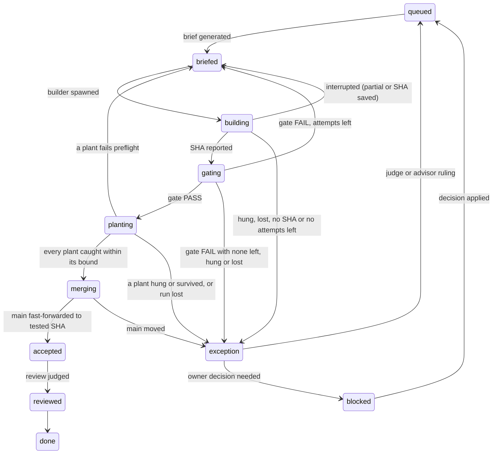

# The build-loop orchestrator, v3.4: `agister`

v3 turned v2's script (R1) into `agister`, a long-running local Go server that owns the state machine and every side effect.

v3.4 applies *Verger orchestration lessons — addendum 2* (L60–L76) to v3.3 as changes C1–C11. A-, B-, G-, L- and R-numbers cite earlier reviews and lessons.

## Concise

`agister` is one Go binary per build machine, one instance per repo, and the only writer of loop state.

- **State is an event log outside the repo.** State is a fold over `~/.agister/repos/<id>/events.jsonl`; the tracker, INBOX and review queue are generated views. Artifacts live there too, never in `/tmp` (C3).
- **Transitions are pure; effects are separate.** Workers report results as events; after a crash or reboot, open intents are reconciled first.
- **Agents are sandboxed subprocesses** (`claude -p`, `codex exec`) in disposable clones with a hard timeout and a result schema; they never run heavy jobs (C1).
- **Load is a machine resource.** Heavy jobs are admitted by measured headroom; stress runs are exclusive (C1).
- **Limits are proven, not predicted.** A hold needs an actual failure and ends when a probe spawn succeeds or the owner says go (C2).
- **The owner acts through commands** over a Unix socket. INBOX holds decisions and incidents only (C8).
- **The architecture is Verger's** (ADR-001). Only persistence, effects and the owner channel differ (§11).

Unchanged from v2: small steps, a fresh agent per run, gates decide, only a test rejects a finding, nothing blocks the build.

## Detailed

### 1. Why a server

It rules out an LLM holding orchestration state (L22), relayed self-reports (L20), state lost to compaction (L23) and hand-added rules that live only in a session (L61).

### 2. The model

| Entity | States |
|---|---|
| **Step** | `queued → briefed → building → gating → planting → merging → accepted → reviewed → done`, plus `exception` and `blocked` |
| **Run** | `requested → waiting(resource) → running → exited(code) \| hung \| lost \| interrupted(cause)` |
| **Review** | `queued → running → exited → judged`, or `interrupted → queued` |
| **Finding** | `open → row \| rejected(covered) \| proven-false \| closed(scope, dup)` |
| **Decision** | `open → answered → applied` |
| **Hold** | `active(reason, evidence) → probing → lifted` |

**`proven-false` needs a recorded plant that the disproving test catches (C10):** a test that passes against the claimed bug proves nothing until it is shown able to fail (L73).



An interrupted gate, plants or merge run reruns on the same SHA (B6). Interruptions skip `exception`, so no judge spawns into a hold (L55). `main moved` goes to a judge on purpose: a rebase changes what was tested.

A transition is a pure Go function, `(State, Event) → (State, []Intent, error)`. Guards replace v1's script refusals (L11): `briefed → building` is refused while another step is between `building` and `merging`, or the module tag is missing (L7). Steps in `exception` or `blocked` don't hold the queue (B3). Refusals are logged.

**Briefs have one source (C4).** A brief is rendered from the repo template plus the step file; no command adds free text to one brief. A new brief rule is a template change, filed as a DEV row, so every later step gets it (L61).

### 3. State and persistence

- **Location (C3).** The log, views, run files, plant patches, partial diffs, owner scripts, locks and socket live in `~/.agister/repos/<id>/`. Only disposable clones may sit in `/tmp`. Builder sandboxes deny `~/.agister/` (A1, A6, B1).
- **Write-ahead (B2).** An intent is fsynced before its effect starts; a result is fsynced before anything acts on it.
- **History.** The state directory is its own git repo, committed at step boundaries and after owner commands; run files stay local and rotate (B8). Back it up by pushing that repo.
- **Reserved paths and views.** A diff touching a reserved path is rejected before gating (A6); a hand-edited view opens an incident and is regenerated.
- **Framing (A10).** One JSON object per line: `v`, `seq`, `ts`, entity, event, payload, cause. On open, a torn final line is truncated as an incident, a `seq` gap refuses start, and a duplicate result is dropped. A binary refuses a newer `v`; old events are folded, never rewritten. Views are replaced by write-then-rename, and a target is always written before anything that points to it (L63).
- **Replay.** `agister replay` rebuilds state from the log alone; shared machine or provider state is logged as an observation, so replay never consults it (B5).

### 4. Effects and reconciliation

| Intent | Worker action |
|---|---|
| `SpawnAgent` | `claude -p --output-format stream-json --verbose --permission-mode <explicit> --json-schema <result>`, or `codex exec --json --output-schema <result> … </dev/null`, in a disposable `git clone --shared`, its only writable path, under `taskpolicy -b` (C1). `agister` fetches the SHA. |
| `RunGate`, `RunPlants` | The scripts at **main's tip**, not the candidate's copy; their SHA is recorded as `tooling` (C5, L66). Throwaway worktree, holding `heavy`. |
| `RunStress` | A load reproduction declared by the step file, holding `exclusive` (C1). |
| `Merge` | `git merge --ff-only <SHA>` where main is checked out, so the owner's files move with it (B4). A dirty checkout refuses: `Hold(merge)` plus an INBOX item. |
| `Notify` | A push with the INBOX item ID. If INBOX can't be written, it carries the whole message (L59). |

`agister` records main after every merge; main moving any other way opens an incident (B1).

**Process launch (A2).** Every process runs under `agister shim` in its own process group (L2), writing `runs/<id>.out` and `.exit`.

**Recovery (A5).** On startup, each open intent is resolved by kind:
- **Process** (pid, start time and boot time recorded): alive → re-attach; exited → emit the result from `.out` and `.exit`; machine rebooted since → `interrupted(reboot)`, no attempt spent (C3); no trace → `lost`.
- **`Merge`:** main is the tested SHA → success; main is the old value → redo; otherwise → `main moved`.
- **`Notify`:** unacknowledged pushes are resent with the same ID. A duplicate push is possible; a missing one is not.

**Time bounds** start at `running`, not `requested`: waiting for a resource never uses up a time box, and `explain` names the holder and queue position (C6, L67). When a bound fires, `agister` kills the process group (L43) and records `hung`. An agent whose file hasn't grown for `stall_seconds` is stalled, whatever it last said (L19, L20). Harness warnings (e.g. classifier unavailable) are recorded; scope is checked mechanically regardless (L74).

**Interruption (A4, A7).** A run `agister` stops on purpose ends `interrupted(disk | output | load | provider | owner | shutdown | reboot)`, never `hung` or `lost`. No attempt is spent, except for `output`: a run that floods its log caused that itself. A dead process never counts as `caught`.

**Plants preflight (C7, L68).** Before the baseline, every patch must apply and build with the module's tags. A failing patch sends the step back to `briefed` with the compiler line, spending the builder's attempt and no `heavy` time.

**Infra failures (C9, L65).** One classifier, built from recorded samples, serves gate and plants alike. A retry fires only when nothing else explains the failure; an independent `FAIL`, race or hang is judged normally. Every retry opens a row for its cause (L57); a class's third hit makes that a root-cause row whose first test replays the recorded failure.

**Disk.** Below `min_free_gb`, every instance stops spawning, interrupts running groups, places `Hold(disk)` and lists the largest files in INBOX, its own run logs first (L48, L49). Each spawn reserves `reserve_gb`, reclaimed when its holder dies (A3, B5).

**Partial work (C11, L75).** A run that ends without a SHA leaves its diff; one that dies after committing leaves its SHA. The next brief names either, plus any `beyond_row` code, as an **unverified reference: review against the step, tests first**; a committed SHA that passes review goes straight to `gating`. When a row's code already exists, its brief says its plants are the only evidence (L51, L71).

### 5. Scheduler and quotas

| Scope | Resources | Mechanism |
|---|---|---|
| Repo | builders, reviews, judges | in-process semaphore |
| Machine | `heavy`, `exclusive`, load admission, disk reservations | `flock` under `~/.agister/`, shared by all instances |
| Provider account | limit holds, probes | `~/.agister/providers.json`, under `flock` |

**Singleton (A11).** Before opening the log, `agister` takes an exclusive `flock` on its state directory. A second instance exits, naming the holder's pid.

```toml
[resources]
heavy    = 1   # machine; gates and plants (L14)
builders = 1   # repo (G2)
reviews  = 5   # repo (L31)
judges   = 5   # repo

[load]
admit_below = 12   # 1-min load; heavy and stress wait above it
abort_above = 24   # interrupts stress, then the newest heavy run

[disk]
min_free_gb = 20
reserve_gb  = 2
log_cap_mb  = 50

[timeouts]
baseline_multiplier = 3
floor_seconds       = 20
builder_minutes     = 20
stall_seconds       = 300
```

Numbers are calibrations (R7). A cap changes only through `agister set <key> <n> --reason`, an event, never waived mid-session (C9, L69). Judges return findings without IDs; `agister` assigns row IDs.

**Load (C1, L60).** The loop's own machine is a live host.
- A heavy run starts only while the 1-minute load is below `admit_below`. Each sample is logged as an observation.
- `exclusive` is granted only after every heavy run and review on the machine has drained, and nothing starts while it is held.
- Above `abort_above`, the stress run is interrupted first, then the newest heavy run, as `interrupted(load)`.
- A test that fails only above a logged load is tagged `load-sensitive` and gets a row. Fixed short sleeps are the usual cause (L72).

**Plants runs are load-sensitive.** While a plants run holds or waits for `heavy`, no review starts, and a plants run starts only once running reviews drain (L50, B7).

**Usage limits (C2, L62).** Limits are recognized from recorded samples (L12).
- A hold is placed only when a run actually fails on a limit, and it carries that failure as evidence.
- The announced reset time is only a hint. At the hint, or on `agister go`, the hold moves to `probing` and one probe spawn runs. Success lifts the hold; failure keeps it, with the new evidence.
- There is no automatic spawn-off; only `agister spawn off` turns spawning off.
- A limited review is interrupted and requeued, never judged (L29).

### 6. Observability

Everything listens on loopback, read-only (A12), behind a token from the `0600` state directory that builders can't read.

| Surface | Shows |
|---|---|
| `GET /` | Steps by state, live runs with elapsed-against-bound bars, load, INBOX, queues, holds, decisions. Server-rendered, SSE. |
| `GET /api/state`, `/api/events?since=N` | JSON for the owner's tools. |
| `GET /runs/{id}/log` | A capped tail of a run file. |
| `GET /metrics` | Cycle time, first-pass rate, false findings, hangs, infra classes, lock wait (R5, R6). |
| `agister status`, `explain <step>`, `retro` | Summary; why a step is stuck; incidents since a date, for batch lessons (L63). |

`explain` names one cause: a resource and its holder, a hold and its evidence, a running process or a failed guard.

Agent output is untrusted:
- all text is HTML-escaped, never rendered as Markdown;
- the CSP is `default-src 'self'`;
- requests with a foreign `Host` header are refused, which blocks DNS rebinding against the loopback server;
- known secret patterns are masked.

Metric triggers, such as a slow time to kill (L56), become rows.

### 7. The owner's interface

Commands travel only over the `0600` Unix socket; each becomes an event:

```
agister go                      # probe and lift holds (C2)
agister decide O3 b
agister hold reviews "limit tight"
agister lift reviews
agister spawn off | on
agister retry <step> --reason "<why>"
agister stage <script>          # regenerate an owner script from the repo (C3)
```

**INBOX holds decisions (with options and a recommended pick) and incidents, nothing else (C8, L70).** Status belongs on the dashboard. A build question goes to the advisor first and reaches the owner only on an `owner` ruling. The recommended pick is applied as `PENDING` at once (L35), so only the step concerned waits. An INBOX line names an `agister stage` command, never a `/tmp` path.

Privileged actions arrive as a complete `!` line with rollback; `agister` never runs `sudo` (L37, L38). `retry` and every `!` line take a reason and open a row retiring their cause, which stays open until its tested replacement is done (L57, L58).

### 8. Judgment stays with agents

Models only build, judge, rule on exceptions, plan milestones and review coherence (R3, R4). Invalid schema output fails the run.

**Scope is measured, then classified (A9).** Changed hunks come from `git diff base..SHA`. The builder's `beyond_row` only classifies them; an unclassified hunk counts as `beyond_row` (L51).

### 9. Testing `agister`

- **Transitions:** table tests over every state and event pair.
- **Workers:** fakes replay real recorded output, including ANSI codes, limit messages and truncated streams (L12).
- **Chaos:** logs reproduce their views byte for byte after kills between effect and result, a torn line or a simulated reboot.
- **Contention:** two repos share `heavy`, `exclusive`, load admission, disk and provider holds correctly; a second instance is refused.
- **Containment:** a builder that writes `~/.agister/`, moves main, reads the token or runs stress outside `RunStress` fails.
- **Holds:** a limit message alone never places a hold; `go` always probes.

### 10. Migration

1. **Shadow.** `agister` only observes the in-tree tracker and ledger (L48).
2. **Drive.** `agister` spawns and accepts; its log becomes the truth. One commit removes the old tracker files and reserves their paths; the ledger and partial diffs leave `/tmp` (C3).
3. **Absorb.** Gates stay scripts unless a metric justifies porting one.

### 11. Borrowed from Verger

`agister` has Verger's shape (ADR-001): one local service as the only authority, a pure core behind ports, workers as adapters, and a loopback dashboard. It takes Verger's settled decisions rather than re-deciding them:

| Concern | From Verger |
|---|---|
| Supervision | §17: `launchd` runs `agister serve` and restarts it after a crash or reboot, so reconciliation runs unattended. The CLI fails fast when it's down. |
| Shutdown | §17: admission stops, then admitted runs drain or end `interrupted(shutdown)`. |
| Web | §13–§16: SSE, embedded assets, method and path checks. |
| Layout | §3: one module per port, one composition root. |
| Diagnostics | §18: `agister doctor` checks the service first. |

Where it differs:
- **Persistence.** Verger keeps in-flight attempts in memory; they last seconds (§24.10). A run lasts 20 minutes and must survive a reboot, hence the write-ahead log.
- **Effects.** Verger's are short provider calls; `agister`'s are heavy process groups, hence load admission and sandboxes.
- **Owner channel.** Verger trusts every process of the user (§15). Builders run as that user, so owner commands use the `0600` socket, not HTTP.

Designs are copied, never imported: a broken Verger step must not break the tool that builds it.

### 12. Risks

- **Meta-software growth (R6).** Own row budget; no gate logic.
- **CLI drift.** Pinned CLI versions (L45), each with fixtures and a containment test.
- **Load calibration.** Too low an `admit_below` starves the loop; too high repeats the reboot. Tune it from logged observations (R7).
- **Single point of failure.** An outside watcher pushes when `agister`'s heartbeat stops (L59).
