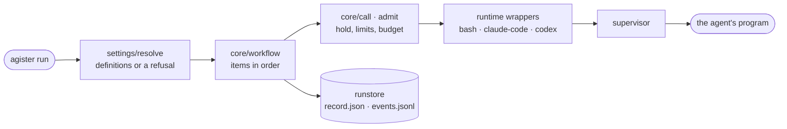

# Showcase: public repos cut from the private monorepo

## The idea

ai-labs holds my AI-SDLC work, and some of its projects are worth showing on my public GitHub profile. The monorepo itself is private: its docs, research and notes hold my thoughts and discussions, and the history names issues, agents and tools that are mine alone.

So each project worth showing gets a small public repo: its code, its tests
and a README written for strangers, with pictures. Nothing else crosses over.
The first is rexlab (LAB-461), then foliotell (LAB-462), then agister
(LAB-543); audelin follows once it has something to show (LAB-463).

## Decisions

- **A fresh snapshot, no history.** A history split (`git subtree split`,
  `filter-repo`) would carry commit messages naming `LAB-*` issues, agister,
  Codex and the docs that were later moved. The public repo gets one commit
  per sync, `Sync from ai-labs@<sha>`.
- **An allowlist, not a denylist.** A new private file stays private unless
  someone adds it to the list.
- **Committed files only.** The export reads `HEAD`, never the working tree,
  so a stray local file cannot leak.
- **Code and tests public; docs private.** The exceptions are rexlab's
  Gherkin, `docs/features/*.feature`: specs plus the tests that check them
  are the best evidence of how the work is done; and agister's two
  architecture pages, which explain a tool with no screens. Every other doc
  stays home.
- **A separate public README.** The project's own README stays written for
  me and the agents; the public one is written for a visitor.

## The lineup

- **[RexLab](https://github.com/igor1309/rexlab)**: a dinosaur learning
  game for children, built with React and TypeScript.
  [Play it](https://rexlab.enoa.ai).
- **[FolioTell](https://github.com/igor1309/foliotell)**: an offline
  iPhone app that reads Markdown and plain-text files aloud, built with
  SwiftUI. [Site](https://foliotell.pages.dev).
- **[Agister](https://github.com/igor1309/agister)**: a Go command-line
  runner for AI-agent work defined in settings files: agents, processes
  and workflows that compose, every run resolved before it starts and
  recorded whole. Pages: [how a run executes](https://igor1309.dev/agister/run-architecture/),
  [how settings resolve](https://igor1309.dev/agister/settings-architecture/).

Agister has no screenshots; its picture is how a run executes:



## The process

Each public project has a `showcase/` folder:

```
<project>/showcase/
  showcase.toml    # private: public repo, metadata, allowlist, check
  screenshots.mjs  # private, optional: retakes the screenshots
  AGENTS.md        # private: the steps no script can do
  public/          # copied as-is to the public repo's root
    README.md
    LICENSE
    screenshots/
```

Only `public/` is public, with no exceptions to remember. `showcase.toml`
names the public repo, its description, homepage and topics, the `include`
and `exclude` globs of committed files, and the `check` command that must
pass inside the export.

Optional `[[allow_marker]]` tables each name a `marker` from the shared list
(case-insensitive) and a nonempty `paths` array of export-relative globs.
Only that marker in matching files is exempt; other files and markers still
stop the export. Optional `[[mount]]` tables carry committed sibling folders:
`source` is repository-relative and outside the project, `target` defaults to
`source`, and `include` / optional `exclude` globs match paths within the source.
Mounts are added after project files and before `public/`; collisions with
selected project files or earlier mounts stop the export. Mounted files pass
the same path checks and marker and secret scans.

One exporter serves every project, `scripts/showcase/export.js`:

1. Export the committed project files at `HEAD` that the allowlist matches,
   then add any mounts.
2. Lay `public/` over them.
3. Stop on a secret (`gitleaks`) or on a non-exempt private marker from the shared
   `scripts/showcase/markers.txt` (`agister`, `multica`, home paths). Issue
   ids such as `LAB-461` are opaque and stay public.
4. Run the project's `check` inside the export, so the public repo builds
   and passes its tests on its own.
5. A plain run stops there, a dry run in a temp directory. `--push` commits
   to the public repo, pushes, and on every push applies the description, homepage and
   topics with `gh repo edit`.

What no script can do lives in the project's `showcase/AGENTS.md`: retaking
the screenshots, deciding when the README needs a rewrite, reading it for
private context, pinning the repo on the profile.
